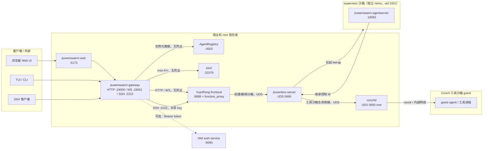
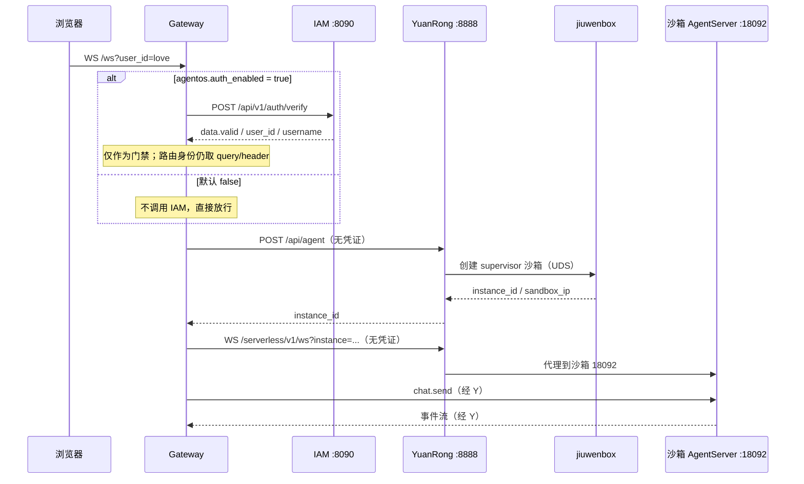
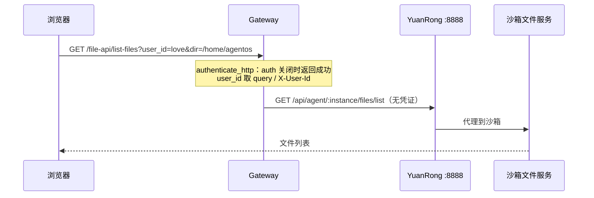
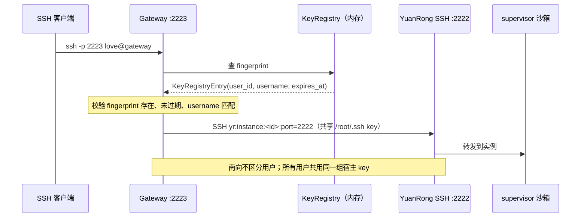

# AgentOS 组件访问关系与接口鉴权分析

> 分析对象：本机部署的 AgentOS / JiuwenSwarm / YuanRong / Conch 组合（2026-11-02）。
> 组织方式：组件清单 → 组件间访问关系 → 每个组件每个接口的鉴权方式。
> 证据口径：文中逐条标注【实测】【代码走查】【推断】【未验证】。
> 代码引用只到函数/类名，不写 `file:line`；检索范围与复现命令见附录 A。

## 0. 结论摘要

1. **AgentOS 当前是“单机 + 可信网络 + 按名字寻址”的部署模型，不是多租户安全边界。**
   组件间的“身份”大多不是认证结果，而是请求参数、实例 ID、UDS 文件权限或网络位置。

2. **真正做了密码学认证的只有四处**：
   - IAM token 校验（`AgentOSAuthenticator`，部署默认关闭）；
   - 北向 SSH 公钥（`SshPublicKeyAuthenticator` + 内存 `KeyRegistry`）；
   - Conch guest 的 `conch-init-token`（每沙箱共享密钥）；
   - 文件下载 HMAC token（`validate_token`）。
   另有可选的 jiuwenbox Bearer token、AgentRegistry API Key，本部署均未启用。

3. **Web 与 TUI 的路由身份由客户端声明。** 即使打开 IAM：
   - Web 通道的 `_resolve_connection_user_id` 只读 query `user_id` / `X-User-Id`；
   - IAM 校验结果在 `apply_auth_result_to_ws` 里本该写回连接，但该函数在当前版本**没有任何调用方**；
   - 结果是“门禁可能是真的，身份仍然是自报的”。

4. **`instance_id` 实际上是一种 bearer capability。**
   AgentRegistry 与 YuanRong 前端都可以匿名枚举实例；Gateway 到实例的 WS/HTTP 代理不带凭证。
   拿到/猜到 `instance_id` 后，能否附着到别人的 AgentServer 取决于 YuanRong 前端是否另做源地址限制——本次未验证。

5. **控制面默认无认证**：AgentRegistry 的实例/镜像接口没有鉴权依赖；etcd 无认证且监听 `*:32379`；
   jiuwenbox 的 UDS 是 `0666`；Conch 控制面 UDS 仅 root，但 guest RPC 的 token 是每沙箱共享的。

6. **对 credproxy 的含义**：不能把 `user_id` 当作归属依据。可信归属只能来自
   jiuwenbox/Conch 的 `sandbox_id` + slot IP + 进程 UID，以及 credproxyd 自己维护的
   credential→binding 映射；AgentRegistry/etcd 的元数据不可作为权威身份源。

## 1. 组件清单

### 1.1 进程、监听面与运行身份

| 组件 | 实际进程 / 单元 | 运行身份 | 监听面 | 主要职责 |
|---|---|---|---|---|
| Web 静态服务 | `jiuwenswarm-web` | 未指定 `User=`，默认 root | `0.0.0.0:5173` | 托管前端静态资源，反向代理到 Gateway `:19000` |
| Gateway | `jiuwenswarm-gateway` | 默认 root（`HOME=/root`） | `7.249.253.56:19000` HTTP、`:19001` WS、`:2223` SSH | 通道接入、鉴权门禁、AgentOS 路由、文件 API、SSH 中继 |
| AgentOSRouter 扩展 | 与 Gateway 同进程 | root | 无独立监听 | `AgentOSAuthenticator`、`RegistryClient`、`AgentManager`、`YuanrongSshRelay` |
| YuanRong 前端 | `goruntime`（`yr start --master`） | root | `7.249.253.56:8888` | `/api/agent` 实例生命周期、`/serverless/v1/*` 代理、实例 SSH 代理 `:2222` |
| YuanRong 函数代理 | `function_proxy` | root | `:22772`–`:22775` | 内置 jiuwenswarm 的 URN 调用与 TCP 隧道 |
| AgentRegistry | `python3.11`（a2x_registry） | root | `7.249.253.56:4003` | 实例注册、镜像/启动规格、心跳 |
| etcd | `etcd` | root | `*:32379`（客户端）、`*:32380`（peer） | Gateway cron 存储、运行时发现 |
| jiuwenbox | `jiuwenbox-server` | root | UDS `/run/jiuwenbox/jiuwenbox.sock`（`0666`） | 创建/管理 supervisor 沙箱，启动 bwrap |
| Conch 控制面 | `conchd` | root | UDS `/var/run/conch/conchd.sock`（`0660 root:root`） | 工具沙箱 / guest 生命周期 |
| 用户 supervisor 沙箱 | `bwrap` + `jiuwenswarm-agentserver` | bwrap 父进程 root，子进程 `agentos` uid 1001 | 沙箱 netns 内 `:18092`，宿主无监听 | 每个用户的 AgentServer |
| Conch 工具沙箱 guest | guest 内进程 | guest 内用户 | slot netns `10.12.x/20`、`tap0 192.168.100.2` | 工具执行、文件操作 |
| IAM 服务 | 外部 `:8090` | — | `7.249.253.56:8090` | `POST /api/v1/auth/verify` |
| Web 客户端 / TUI / SSH 客户端 | 外部 | — | — | 北向接入 |

补充事实：

- supervisor 沙箱由 **jiuwenbox-server 直接拉起**（bwrap 的 PPID 是 `jiuwenbox-server`），
  不是 Gateway 或 YuanRong 直接 `exec`。
- 沙箱内 `jiuwenswarm-agentserver` 以 uid 1001 运行，位于独立 netns（`--unshare-pid/ipc/cgroup/uts`，
  未 `--unshare-net`），宿主上没有 `18092` 监听。
- Gateway 到 YuanRong 的所有调用（创建实例、聊天、文件）都经 **YuanRong 前端**；
  Gateway 不直接连 jiuwenbox 或 Conch。

### 1.2 信任域划分



## 2. 组件间访问关系

### 2.1 访问矩阵

| 源 | 目标 | 传输 / 地址 | 接口 | 携带的凭证 | 执行鉴权的位置 |
|---|---|---|---|---|---|
| 浏览器 | Web 静态 | HTTP `:5173` | 静态资源、反向代理 | 无 | 无 |
| 浏览器 | Gateway | HTTP `:19000` | `/file-api/*`、`/api/trajectory/*`、`/api/v1/auth/*` | query `user_id` / `X-User-Id`；可选 IAM token；下载 token | Gateway 进程 |
| 浏览器 | Gateway | WS `:19001` | `/ws`、`/ws/git` | 可选 IAM token；query/header `user_id` | Gateway 进程 |
| TUI | Gateway | WS `:19001` | `/tui` | 可选 IAM token；`X-User-Id` | Gateway 进程 |
| SSH 客户端 | Gateway | SSH `:2223` | 交互 shell / 远端命令 | 临时 ssh-ed25519 公钥 | Gateway 进程 |
| Gateway | IAM | HTTP `:8090` | `POST /api/v1/auth/verify` | `Authorization: Bearer <token>` | IAM 服务 |
| Gateway | YuanRong | HTTP `:8888` | `/api/agent`、`/api/agent/:id/files/*`、`/serverless/v1/functions/<urn>/invocations` | 无（仅 `X-Trace-Id`、`X-Instance-Session`、`X-Session-Context`） | 无 |
| Gateway | YuanRong | WS `:8888` | `/serverless/v1/ws?instance=...&tenant_id=...&port=...` | 无（仅 `X-Trace-Id`） | 无 |
| Gateway | YuanRong SSH | SSH `:2222` | `yr:instance:<id>:port=2222` | `/root/.ssh` 下的共享私钥 | YuanRong 前端 |
| Gateway | AgentRegistry | HTTP `:4003` | `/api/instances`、`/api/images/*` | 无 | 无（实例/镜像路由无鉴权依赖） |
| Gateway | etcd | HTTP/gRPC `:32379` | cron KV | 无 | 无 |
| YuanRong | jiuwenbox | UDS `/run/jiuwenbox/jiuwenbox.sock` | 创建/删除/查询沙箱 | UDS 文件权限；可选 Bearer（未配置） | jiuwenbox |
| jiuwenbox | Conch | UDS `/var/run/conch/conchd.sock` | 工具沙箱生命周期 | UDS 文件权限（root 可写） | conchd |
| YuanRong | supervisor AgentServer | WS 代理到 `:18092` | Agent 协议 | 无 | AgentServer（仅可选 Origin 检查） |
| 沙箱进程 | jiuwenbox | 继承的 control fd | 沙箱控制协议 | fd 本身（`0600`，父目录 `0700`） | jiuwenbox |
| 沙箱 / guest | Conch guest agent | 内部 HTTP / vsock | 进程、文件 RPC | `conch-init-token` | guest agent |
| AgentRegistry | etcd / 本地存储 | 视部署 | 心跳、实例状态 | 无 | — |

### 2.2 三条主链路

**（1）Web 聊天链路**



**（2）文件访问链路**



**（3）SSH 链路**



## 3. 各组件接口鉴权明细

### 3.1 jiuwenswarm-web（`:5173`）

| 接口 | 鉴权方式 | 说明 |
|---|---|---|
| 静态资源 | 无 | 只读前端文件 |
| 反向代理到 Gateway `:19000` | 无 | 鉴权完全由 Gateway 承担 |

执行位置：`jiuwenswarm-web` 进程本身不做身份判断。它不是安全边界。

### 3.2 Gateway WebSocket（`:19001`）

| 路径 | 用途 | 鉴权方式 | 执行位置 |
|---|---|---|---|
| `/ws` | Web 通道 | 可选 IAM 握手门禁；路由身份取 query `user_id` 或 `X-User-Id` | `WebChannel` + `AgentOSRouterClient` |
| `/ws/git` | Git 相关 WS | 独立的 Origin 检查；未观察到用户级鉴权 | Web 通道 |
| `/tui` | TUI 通道 | 可选 IAM 握手门禁；路由身份取 `X-User-Id` / query | `TuiChannel` |
| `/acp` | ACP 通道 | 由 ACP 桥接层处理；不在 AgentOS 身份链上 | ACP 桥接 |
| 其他路径 | — | 直接以 `1008` 关闭 | `GatewayServer` |

关键行为（代码走查）：

- `_reject_disallowed_origin` 只在 `JIUWENSWARM_ENABLE_ORIGIN_CHECK=1` 时生效；
  本部署的 systemd 环境**没有设置**该变量，也没有 allowlist。
- `_reject_unauthorized_handshake` 调用 `channel.authenticate_handshake`。
  返回 `None` 表示“未配置鉴权”→ 放行；返回成功时把 IAM `user_id` 挂到 adapter 的
  `authenticated_user_id`。
- `WebChannel._resolve_connection_user_id` 的注释明确写着：会话身份以客户端声明为准
  （query `user_id` / `X-User-Id`，值为 username）；IAM UUID 只作认证门禁，
  **不参与工作区/沙箱身份推导**。
- `auth/common.apply_auth_result_to_ws` 与 `take_handshake_auth` 在当前包内**没有调用方**；
  IAM 结果不会写回 `ws.user_id` / `_gateway_user_id`。
- `authenticate_http` 在 `channel == "web"` 且 `auth_enabled=false` 时，
  会用 query `user_id` 覆盖 `_verify_request_token` 返回的 `X-User-Id`。
- 即使 `auth_enabled=true`，Web 通道也只要求 IAM `user_id` 非空，不与 query/header 声明的
  `user_id` 做比对。

结论：**Web/TUI 的“认证”和“身份”是两件事**。门禁可以挡住无效 token，但挡不住
“用 A 的 token 声明 B 的身份”。

### 3.3 Gateway HTTP（`:19000`）

| 接口 | 方法 | 鉴权方式 | 执行位置 |
|---|---|---|---|
| `/file-api/list-files` | GET | `client.authenticate_http`；auth 关闭时 query/header `user_id` 直接生效；auth 开启时再做 token 身份比对 | Gateway 文件 API 中间件 |
| `/file-api/list-markdown` | GET | 同上 | 同上 |
| `/file-api/file-content` | GET | 同上 | 同上 |
| `/file-api/raw-file` | GET | 同上 | 同上 |
| `/file-api/download` | GET | 同上；query 中的 `token` 不当作 IAM 凭证（`allow_query_token=False`） | 同上 + 沙箱内 `validate_token` |
| `/file-api/upload` | POST | 同上 | 同上 |
| `/file-api/mkdir` | POST | 同上 | 同上 |
| `/api/trajectory/*` | GET | 仅 Origin 校验（且 Origin 检查默认关闭）；无用户级鉴权 | Web 通道 |
| `/api/v1/auth/*` | POST/GET | 华为账号登录；会话 Cookie `jiuwenswarm_auth` 或 `X-Auth-Session`；写操作要求 `X-Jiuwen-Auth: 1` | `web_http_auth` |
| Web 应用代理（web_proxy） | HTTP/WS | IAM 开启时要求“声明的 user_id 属于 token 的 uid/username”；关闭时直接用 query `user_id` | `_authenticate_web_proxy` |

关键行为：

- `/file-api/*` 的中间件在 `client.auth_enabled == false` 时直接返回成功；
  随后 `_resolve_user_id` 使用 query 或 header。**这就是“声明谁就能读谁”的入口。**
- 当 `client.auth_enabled == true` 时，文件 API 会调用 `_user_id_mismatch_against_token`，
  比对声明值与 IAM uid/username；这条路径比 Web WS 严格。
- Web 账号登录（华为账号）与 WS 路由身份是两套东西：Cookie 只用于登录态展示/接口，
  不会被 `_resolve_connection_user_id` 消费。

### 3.4 Gateway SSH（`:2223`）

| 项 | 方式 |
|---|---|
| 北向认证 | SSH 公钥；`SshPublicKeyAuthenticator.verify(fingerprint, username)` |
| 凭证来源 | `AgentOSSshKeyIssuer.issue_ephemeral_key` 生成临时 `ssh-ed25519`，写入内存 `KeyRegistry` |
| 绑定关系 | `fingerprint → KeyRegistryEntry(user_id, username, source, session_id, expires_at)` |
| 用户名校验 | 必须与条目中的 `username` 一致；签发时 `username = user_id` |
| 有效期 | 部署配置 `ephemeral_key_ttl_sec: 300` |
| 主机密钥 | `~/.jiuwenswarm/config/ssh_host_key` |
| 南向认证 | `YuanrongSshRelay` 使用 `/root/.ssh` 下的共享私钥；用户名模板 `yr:instance:{instance}:port=2222`；`known_hosts=None` |

关键行为：

- 临时密钥由 `3rdagent.switch` 触发签发，返回体里带 `ssh_private_key`。
  该接口读取 envelope/连接上的 `user_id`；在 auth 关闭时，这个值来自客户端声明。
- 南向**没有 per-user key**：`client_keys_dir` 未配置，默认 `/root/.ssh`；
  模板里没有 `{user_id}`，所有用户共用同一组宿主 key。

### 3.5 Gateway 对下游的客户端凭证

| 下游 | 客户端 | 是否带凭证 | 说明 |
|---|---|---|---|
| IAM `:8090` | `AgentOSAuthenticator` | 是 | `Authorization: Bearer <token>`；body `{token, resource_id:"apps", action_id:"read"}` |
| YuanRong `:8888` | `YuanrongFrontendAgentClient` | 否 | 只带 `X-Trace-Id`、`X-Instance-Session`、`X-Session-Context`、`Accept` |
| YuanRong SSH `:2222` | `YuanrongSshRelay` | 是（共享 key） | `/root/.ssh` 下 `id_ed25519`、`id_rsa`、`agent_key` 等 |
| AgentRegistry `:4003` | `RegistryClient` | 否 | 没有 API Key 配置；与 registry 的 auth 模块不匹配 |
| etcd `:32379` | cron 存储 | 否 | 纯 HTTP/gRPC，无认证 |
| jiuwenbox | 由 YuanRong 调用 | 否 | 无 `JIUWENBOX_API_TOKEN` |

IAM 校验的一个细节：`AgentOSAuthenticator` 只消费响应里的 `data.valid`，
**不消费 `authorized`**；即“token 合法”就放行，资源级授权（`apps/read`）没有落地。
代码注释也明确写了这一点。

### 3.6 YuanRong 前端（`:8888`）

| 接口 | 方法 | 鉴权方式 | 证据 |
|---|---|---|---|
| `/api/agent` | GET | 无 | 【实测】匿名 200，返回所有实例 |
| `/api/agent` | POST | 无 | 【代码走查】Gateway 调用不带 Authorization |
| `/api/agent/:id` | GET / DELETE | 无 | 【代码走查】 |
| `/api/agent/:id/files/list` | GET | 无（Gateway 可选透传 `auth_headers`，但 Gateway 自身不产生） | 【代码走查】 |
| `/api/agent/:id/files/upload` | POST | 同上 | 【代码走查】 |
| `/api/agent/:id/files/download` | GET | 同上 | 【代码走查】 |
| `/serverless/v1/functions/<urn>/invocations` | POST | 无 | 【代码走查】只带 trace/session 头 |
| `/serverless/v1/ws` | WS | 无 | 【代码走查】只带 `X-Trace-Id` |
| `/serverless/v1/http` | HTTP | 无 | 【代码走查】 |
| SSH `:2222` | SSH | 共享宿主 key；用户名编码 instance | 【代码走查】 |

`instance_id` 的来源：

- 内置 `jiuwenswarm` 走 URN 调用，实例由 YuanRong 管理；
- 第三方 `agent_type` 走 AgentRegistry 的 launch-spec + `POST /api/agent` 创建；
- 两种情况下 Gateway 拿到的都是 `instance_id`，后续 WS/文件接口都用它寻址。

**未验证**：YuanRong 前端是否对 `/serverless/v1/ws` 做源 IP/租户校验。
本次没有做跨用户 WS 附着测试，避免影响运行中的实例。

### 3.7 沙箱内 AgentServer（`:18092`）

| 接口 | 鉴权方式 | 执行位置 |
|---|---|---|
| WebSocket Agent 协议 | 无 token；只有可选 Origin 检查 | `agent_ws_server._process_request` |
| 连接建立 | 直接 accept 并回 `connection.ack` | `_connection_handler` |
| 身份来源 | 请求 payload / session metadata 中的 `user_id`；不做校验 | 同上 |
| 文件下载 token | `validate_token` 校验 HMAC、`exp`（若存在）、session、kind、owner | 沙箱内文件工具 |

网络位置是这里唯一的“隔离”：

- AgentServer 只监听沙箱 netns 内的 `:18092`，宿主没有监听；
- 外部只能经 YuanRong 的实例代理进入；
- 因此“能否连上”取决于是否知道 `instance_id` 以及 YuanRong 的转发策略，而不是 token。

### 3.8 jiuwenbox

| 接口 | 鉴权方式 | 执行位置 |
|---|---|---|
| `GET /api/v1/sandboxes` | UDS 权限；可选 `Authorization: Bearer <JIUWENBOX_API_TOKEN>`（未配置） | jiuwenbox-server |
| `GET /api/v1/policies/<id>` | 同上 | 同上 |
| 创建/删除沙箱 | 同上 | 同上 |
| 每沙箱 control socket | `0600`，父目录 `0700`；通过继承 fd 传递；未观察到 `SO_PEERCRED` 或 token 校验 | jiuwenbox-server / 沙箱 daemon |

【实测】`/run/jiuwenbox/jiuwenbox.sock` 权限为 `srw-rw-rw-`（`0666`）；
以普通 uid 1000 匿名 `GET /api/v1/sandboxes` 返回 200，能看到两个沙箱的 `id`、`pid`、`ip_address`。
jiuwenbox 以 root 运行，所以“能写这个 socket”约等于“能在宿主上创建/控制沙箱进程”。

### 3.9 Conch

| 接口 | 鉴权方式 | 执行位置 |
|---|---|---|
| 控制面 UDS `/var/run/conch/conchd.sock` | 文件权限 `0660 root:root`、父目录 `0750`；无应用层 token | conchd |
| `/health` | 无 | conchd |
| guest 进程/文件 RPC | 每沙箱 `conch-init-token` 请求头，常量时间比较 | guest agent |
| 沙箱互访 | 默认可达；靠 netns / slot IP / SNAT 做传输层区分 | Conch 网络 |

要点：

- 控制面“鉴权”实质是 **root 等价**：能写这个 UDS 的进程可以在宿主上管理所有沙箱。
- guest RPC 的 token 是**每沙箱共享**，不是每请求、也不是每用户；
  拿到某个沙箱的 token 就能操作该 guest，但拿不到别的沙箱的 token。
- 没有观察到 per-sandbox egress 策略；同网段沙箱默认可互访。

### 3.10 AgentRegistry（`:4003`）

| 接口 | 方法 | 鉴权方式 | 证据 |
|---|---|---|---|
| `/api/instances` | GET | 无 | 【实测】匿名 200，返回 user / service_id / instance_id / address |
| `/api/instances` | POST | 无 | 【代码走查】`instance/router.py` 路由没有 `Depends(authorize)` |
| `/api/instances/{service_id}` | PATCH | 无 | 同上 |
| `/api/instances/{service_id}` | DELETE | 无 | 同上 |
| `/api/images` | GET / POST | 无 | 【实测】匿名 GET 200；【代码走查】image 路由无鉴权依赖 |
| `/api/images/{framework}/launch-spec` | GET | 无 | 同上 |
| `/api/images/{framework}/default` | PUT | 无 | 同上 |
| `/api/images/{framework}/{version}` | DELETE | 无 | 同上 |
| `/api/auth/*` | — | auth 模块未初始化时返回 404 | 【实测】`/api/auth/whoami` 404 |
| `/api/dataset/*` | — | auth 模块存在命名空间策略；本部署未初始化 | 【代码走查】 |
| 心跳 | POST | `Depends(authorize)`；store 为 None 时匿名放行 | 【代码走查】 |

要点：

- 仓库里的 registry **有**完整的 API Key / namespace / admin 模型，
  但部署上 `a2x-registry auth init` 没有执行，`get_auth_store()` 返回 `None`，
  所有 `authorize` 走“匿名快路径”。
- **实例与镜像路由连 `Depends(authorize)` 都没有**，所以即使以后初始化了 auth store，
  这两组接口仍然不会自动受保护，需要改代码。
- Gateway 的 `RegistryClient` 没有 API Key 配置；即使现在开启 registry auth，
  Gateway 的下游调用也会失败，需要同步改造。

### 3.11 etcd（`:32379`）

| 项 | 事实 |
|---|---|
| 认证 | 无（`--enable_etcd_auth=false --etcd_auth_type=Noauth`） |
| TLS | 无（`--ssl_enable=false --ssl_downgrade_enable=true`） |
| 监听 | `*:32379`、`*:32380` |
| 实测 | 【实测】匿名 `POST /v3/kv/range` 返回 header，未鉴权 |
| 使用者 | Gateway cron（`/jiuwenswarm/cron/jobs/`）；沙箱 env 里也配置了 `JIUWENBOX_ETCD_ENDPOINTS` |

能读 etcd 不等于能直接读用户文件，但可以篡改 cron、运行时发现等数据；
作为“身份/归属”的数据源时不可信。

### 3.12 IAM 服务（`:8090`）

| 项 | 事实 |
|---|---|
| 接口 | `POST /api/v1/auth/verify` |
| 请求 | `{token, resource_id:"apps", action_id:"read"}` + `Authorization: Bearer <token>` |
| 响应消费 | 只取 `data.valid`、`data.user_id`、`data.username`、`data.role` |
| 未消费 | `data.authorized`（资源级授权） |
| 调用条件 | `gateway.agentos.auth_enabled: true`；本部署为 `false` |
| 调用方 | Gateway 的 `AgentOSAuthenticator` |

### 3.13 文件下载 token

| 项 | 事实 |
|---|---|
| 格式 | `base64url(JSON payload) + "." + hex(HMAC-SHA256)` |
| 校验 | `validate_token(check_expiry=True)`：签名常量时间比较、JSON dict、`exp`（若存在）、session、kind、owner |
| 无 `exp` 的情况 | 交付型产物故意不设过期；只允许精确的 legacy 字段集合 |
| 作用域 | 单个文件/资产的能力令牌，不是用户身份凭证 |
| 执行位置 | 沙箱内文件工具；Gateway 只做路由提示，不代替授权 |

## 4. 身份是如何传播的

### 4.1 Web/TUI 链路

```text
query user_id / X-User-Id
  → ws._gateway_user_id / ws._web_connection_user_id
  → AgentOSRouter 的 envelope.user_id
  → workspace = /home/agentos/users/<user_id>
  → sandbox name = <user_id>+<agent_type>
  → env JIUWENSWARM_USER_DIRECTORY=/home/agentos/users/<user_id>
  → X-Session-Context: {"sessionCtx": <user_id>} 发给 YuanRong
  → YuanRong 用它把实例/工作区绑定到该 uid
```

`resolve_agent_workspace` 只校验路径存在且是目录，
**不校验属主、权限、是否属于该 user_id**。`AgentManager` 的 key 是 `(user_id, agent_type)`，
连接计数和空闲回收也按这个 key 做。

### 4.2 SSH 链路

```text
3rdagent.switch(user_id) 
  → issue_ephemeral_key(user_id, username=user_id, session_id, ttl=300)
  → KeyRegistry[fingerprint] = (user_id, username, session_id, expires_at)
  → 客户端拿到 ssh_private_key
  → ssh -p 2223 <user_id>@gateway
  → verify(fingerprint, username) 命中且 username 一致
  → YuanrongSshRelay 用共享宿主 key 连 YuanRong :2222
  → 用户名 yr:instance:<instance_id>:port=2222
```

北向是密码学绑定；南向只按 instance 寻址，不区分用户。

### 4.3 实例链路

```text
user_id + agent_type
  → AgentManager 缓存 runtime
  → YuanRong POST /api/agent 或 URN invoke
  → instance_id / sandbox_id / sandbox_ip
  → WS: /serverless/v1/ws?instance=<id>&tenant_id=default&port=<port>
  → 文件: /api/agent/<id>/files/*
```

`instance_id` 是后续所有操作的唯一句柄；它本身没有签名、没有绑定证明。
`tenant_id` 在本部署固定为 `default`，不承担隔离作用。

### 4.4 一个值得注意的实测现象

当前宿主上 `/home/agentos/users/love` 已不存在，但 love 的 bwrap 仍以
`--bind /home/agentos/users/love /home/agentos` 运行，文件 API 也仍能列出其工作区。
这说明：

- 工作区绑定发生在**沙箱创建时**，之后宿主路径变化不会重新校验；
- 沙箱的“身份”在创建后是冻结的；
- 不能用“当前路径是否存在/属主是谁”反推运行中沙箱的归属。

这不改变鉴权结论，但对 reconciler/归属逻辑很重要：归属应以沙箱对象和 bind mount 为准，
而不是以当前文件系统状态为准。

## 5. 结论：哪些是认证，哪些只是寻址

| 机制 | 性质 | 能否作为身份依据 |
|---|---|---|
| IAM `/api/v1/auth/verify` | 密码学 token 校验（可选） | 能证明“token 属于某人”，但当前未绑定到路由身份 |
| 北向 SSH 公钥 + KeyRegistry | 密码学认证 | 能证明“持有某次签发的私钥”；签发输入仍是声明的 user_id |
| Conch `conch-init-token` | 每沙箱共享密钥 | 能证明“属于该沙箱”；不是用户身份 |
| 文件下载 HMAC token | 能力令牌 | 能证明“被授权访问该文件”；不是用户身份 |
| jiuwenbox Bearer | 可选共享密钥 | 本部署未启用 |
| Registry API Key | 可选 | 本部署未初始化 |
| `user_id` / `X-User-Id` | 自报字段 | **不能** |
| `X-Session-Context` | 自报字段 | **不能**；只用于下游绑定 |
| `instance_id` | 寻址句柄 | **不能**单独作为归属证明 |
| UDS 文件权限 / 进程 UID | 本地访问控制 | 能证明“本机某个 uid/root 可访问”；不是用户身份 |
| netns / slot IP / SNAT | 网络位置 | 能证明“流量来自某个沙箱位置”；需与沙箱对象关联 |
| Origin 检查 | 浏览器侧约束 | 默认关闭；不是身份认证 |

## 6. 风险清单

| 级别 | 问题 | 影响 | 证据 |
|---|---|---|---|
| 严重 | Web/TUI 路由身份完全由客户端声明；IAM 开启也不绑定 | 任意声明 `user_id` 即可进入他人工作区/沙箱 | 【实测】`/file-api/list-files?user_id=love` 匿名 200；【代码走查】`_resolve_connection_user_id` |
| 严重 | `instance_id` 可匿名枚举，Gateway→YuanRong WS 无凭证 | 可能附着到他人 AgentServer，读取/注入会话 | 【实测】registry 与 `/api/agent` 匿名可列；【代码走查】`_connect_ws_until_ready` 无 Authorization；【未验证】实际附着 |
| 高 | AgentRegistry 实例/镜像接口无鉴权且可写 | 污染/删除实例元数据，替换第三方 agent 的 launch-spec | 【代码走查】`instance/router.py` 无 `Depends(authorize)`；【实测】匿名 GET |
| 高 | etcd 无认证、监听所有地址 | 篡改 cron、读取运行时键；为后续横向移动提供信息 | 【实测】匿名 range；【实测】`--enable_etcd_auth=false` |
| 中 | jiuwenbox UDS `0666` 且无 token | 本机任意用户可列举/创建/控制沙箱 | 【实测】匿名 UDS GET 200 |
| 中 | 北向 SSH key 按声明 `user_id` 签发 | auth 关闭时可匿名获取他人 SSH key | 【代码走查】`thirdagent_switch` → `issue_ephemeral_key(user_id=...)`；【推断】 |
| 中 | 南向 SSH 使用共享 `/root/.ssh` key，`known_hosts=None` | 无法区分用户/实例来源；易受中间人 | 【代码走查】`ssh_relay` |
| 中 | 交付型文件下载 token 无 `exp` | 链接长期有效；依赖文件生命周期兜底 | 【代码走查】`generate_token` / `validate_token` |
| 中 | IAM 只校验 `valid`，忽略 `authorized` | token 合法即可通过，资源级授权未生效 | 【代码走查】`AgentOSAuthenticator` |
| 低 | Origin 检查默认关闭，systemd 未设置 | 浏览器侧跨站 WS 风险 | 【实测】无相关环境变量 |
| 低 | `/api/trajectory/*` 仅 Origin 校验，无用户鉴权 | 可读取会话轨迹 | 【代码走查】 |
| 低 | Web 静态服务 `:5173` 无鉴权 | 只读静态资源；代理面由 Gateway 承担 | 【实测】 |

## 7. 对 credproxy 的约束

1. **不要用 `user_id` 作为凭证归属。** 它可以被任意声明，且 IAM 开启后也未绑定到
   Web/TUI 路由身份。
2. **可信归属应来自沙箱对象，而不是请求参数。** 可用：
   - jiuwenbox `GET /api/v1/sandboxes` 的 `id` / `ip_address` / `pid`；
   - Conch 控制面的 `sandbox_id` / `domain`；
   - 宿主 netns / slot IP 与沙箱对象的对应关系；
   - 沙箱内进程 UID（uid 1001）与 bind mount。
3. **token 归属由 credproxyd 自己维护。** 捕获规则可以按 slot IP 门控，但“这个请求属于哪个
   credential”必须由 credproxyd 的 credential→binding 映射决定，不能从 URL/头/query 推导。
4. **AgentRegistry / etcd 不能作为权威身份源。** 它们可匿名读写；只能作为发现/缓存，
   且要校验与 jiuwenbox/Conch 的一致性。
5. **`instance_id` 视为不可信输入。** 如果 credproxy 用它做 key，必须同时校验
   sandbox 对象、slot IP 和生命周期，避免 slot IP 复用/实例重建导致的错配。
6. **1:1 绑定仍然成立。** 多用户下不能把一个 token 复制给多个用户；否则即使捕获正确，
   也无法从 token 反推真实使用者。

## 8. 加固建议

### 8.1 部署层（不改代码即可做）

1. 把 AgentRegistry（`:4003`）、etcd（`:32379/32380`）、YuanRong（`:8888`、`:22772-22775`）
   限制在 loopback / 管理网 / 防火墙白名单，不暴露给用户网段。
2. 给 jiuwenbox 设置 `JIUWENBOX_API_TOKEN`，并把 UDS 权限从 `0666` 收紧到 `0660 root:root`。
3. 设置 `JIUWENSWARM_ENABLE_ORIGIN_CHECK=1` 与 `JIUWENSWARM_WS_ALLOWED_ORIGIN_HOSTS`。
4. 南向 SSH 配置 `known_hosts`，不要用 `known_hosts=None`；按用户拆分 `client_keys_dir`。
5. 对 `/api/trajectory/*` 增加用户级鉴权，或限制到管理网。
6. 执行 `a2x-registry auth init`，并给 Gateway 的 `RegistryClient` 配置 API Key；
   注意实例/镜像路由还需要补 `Depends(authorize)`，否则初始化 auth 也不生效。

### 8.2 代码层（需要改造）

1. **把 IAM 身份真正绑定到连接**：
   - Web/TUI 握手成功后，用 IAM `username` 作为路由身份；
   - 若客户端声明了 `user_id`，要求它等于 IAM `username`（或映射表命中）；
   - 删除/启用 `apply_auth_result_to_ws` 这条死代码路径，避免“看起来绑定了”。
2. **AgentServer 增加实例级凭证**：Gateway→YuanRong→AgentServer 的 WS/HTTP 带一个
   per-instance token（由 YuanRong 签发、AgentServer 校验），不要只靠 `instance_id`。
3. **YuanRong 前端增加源地址/租户校验**：至少限制 `/serverless/v1/ws` 只接受来自
   Gateway 的连接；`tenant_id` 不要固定为 `default`。
4. **Registry 实例/镜像路由补鉴权**：在路由层加 `Depends(authorize)` 或 `require_principal`，
   并对 `POST/PATCH/DELETE` 做 admin 限制。
5. **Conch 增加每沙箱 egress 策略**：至少阻止同网段沙箱互访；guest token 改为每请求
   短期凭证，而不是沙箱生命周期内共享。
6. **文件下载 token 收紧**：对交付型产物也设置合理 `exp`，或在下载时校验当前用户/沙箱归属。

### 8.3 架构层

- 把“宿主 root 域”视为**单一信任域**：Gateway、YuanRong、Registry、etcd、jiuwenbox、Conch
  之间没有强隔离。多租户安全边界不能建立在这个域内部。
- 若需要真正的多租户，至少要做到：每用户独立 Gateway/网络命名空间，或组件间 mTLS +
  每用户凭证；仅靠 `user_id` 字段和 UDS 权限不够。

## 附录 A 检索范围与复现命令

以下命令用于支撑文中“不存在/未启用”的判断。命令只读，不会修改部署。

```bash
# 1. 当前部署的 jiuwenswarm 代码位置
python3 -c 'import jiuwenswarm, os; print(os.path.dirname(jiuwenswarm.__file__))'

# 2. IAM 结果是否写回连接（应为只有定义、无调用方）
grep -rn 'apply_auth_result_to_ws\|take_handshake_auth' \
  /usr/local/lib/python3.11/dist-packages/jiuwenswarm

# 3. Web 路由身份来源
grep -n -A10 'def _resolve_connection_user_id' \
  /usr/local/lib/python3.11/dist-packages/jiuwenswarm/gateway/channel_manager/web/web_connect.py

# 4. Gateway 到 YuanRong 的 WS 是否带 Authorization
grep -n -A40 'def _connect_ws_until_ready' \
  /usr/local/lib/python3.11/dist-packages/jiuwenswarm/extensions/agentos/agentos_router/router_client.py

# 5. Registry 实例路由是否有鉴权依赖（应无）
grep -n 'Depends(authorize)' \
  /home/yxy/code/jiuwen/agentos-enterprise/agent-protocol/AgentRegistry/a2x_registry/instance/router.py

# 6. Registry 镜像路由是否有鉴权依赖（应无）
grep -n 'Depends(authorize)' \
  /home/yxy/code/jiuwen/agentos-enterprise/agent-protocol/AgentRegistry/a2x_registry/image/router.py

# 7. 部署配置中的关键开关
grep -nE 'auth_enabled|auth_service_url|workspace_root|user_template|client_keys_dir' \
  /root/.jiuwenswarm/config/config.yaml

# 8. Gateway 是否设置了 Origin / token 环境变量
systemctl show jiuwenswarm-gateway.service -p Environment --value

# 9. 监听面
ss -ltnp | grep -E ':(5173|19000|19001|2223|4003|8888|32379|32380|2277[2-5])\b'

# 10. UDS 权限
ls -l /run/jiuwenbox/jiuwenbox.sock /var/run/conch/conchd.sock

# 11. 沙箱的 bind mount 与身份环境变量
ps -eo pid,user,args | grep -E 'bwrap|jiuwenswarm-agentserver' | grep -v grep
tr '\0' '\n' < /proc/<bwrap-pid>/environ | grep -E 'JIUWENSWARM_USER_DIRECTORY|SANDBOX_IP'

# 12. 匿名访问实测（只读）
curl -s -o /dev/null -w '%{http_code}\n' \
  'http://7.249.253.56:19000/file-api/list-files?user_id=love&dir=/home/agentos'
curl -s 'http://7.249.253.56:4003/api/instances'
curl -s 'http://7.249.253.56:8888/api/agent'
curl -s --unix-socket /run/jiuwenbox/jiuwenbox.sock \
  'http://localhost/api/v1/sandboxes'
```

## 附录 B 实测记录（2026-11-02）

| 编号 | 操作 | 结果 |
|---|---|---|
| M1 | 匿名 `GET /file-api/list-files?user_id=love&dir=/home/agentos` | HTTP 200，返回 love 工作区文件列表 |
| M2 | 匿名 `GET /file-api/list-files?user_id=alice&dir=/home/agentos` | HTTP 200 |
| M3 | 匿名 `GET /file-api/list-files?dir=/home/agentos` + `X-User-Id: love` | HTTP 200 |
| M4 | 匿名 `GET http://7.249.253.56:4003/api/instances` | HTTP 200，返回 alice/love 的 user、service_id、instance_id、address |
| M5 | 匿名 `GET http://7.249.253.56:8888/api/agent` | HTTP 200，返回两个 supervisor 实例 |
| M6 | 匿名 `GET http://7.249.253.56:4003/api/auth/whoami` | HTTP 404，`Auth is not initialized` |
| M7 | 匿名 `GET http://7.249.253.56:4003/api/images` | HTTP 200，返回 `[]` |
| M8 | 匿名 `GET /api/images/jiuwenswarm/launch-spec` | HTTP 404，无镜像记录（不是鉴权拒绝） |
| M9 | 匿名 `POST http://7.249.253.56:32379/v3/kv/range` | 返回 etcd header，无鉴权 |
| M10 | 以 uid 1000 匿名 `GET /run/jiuwenbox/jiuwenbox.sock /api/v1/sandboxes` | HTTP 200，返回沙箱 id/pid/ip |
| M11 | `ls -l /run/jiuwenbox/jiuwenbox.sock` | `srw-rw-rw-`（0666） |
| M12 | `ls -l /var/run/conch/conchd.sock` | `srw-rw----`（0660 root:root） |
| M13 | `systemctl show jiuwenswarm-gateway.service -p Environment` | 无 `JIUWENSWARM_ENABLE_ORIGIN_CHECK` / token 变量 |
| M14 | `ps` 查看 bwrap 与 agentserver | bwrap 父进程为 `jiuwenbox-server`；agentserver 以 uid 1001 运行 |
| M15 | 查看 love 的 bwrap 参数 | `--bind /home/agentos/users/love /home/agentos`；该宿主路径当前已不存在，但挂载仍有效 |

【未验证】项：

- 跨用户 WS 附着到他人 `/serverless/v1/ws`（未执行，避免影响运行实例）；
- YuanRong 前端是否对实例代理做源 IP / 租户限制；
- 在 auth 关闭时实际调用 `3rdagent.switch` 获取他人 SSH key（只做了代码走查）；
- Conch guest 之间的实际互访（只看了网络配置）。
