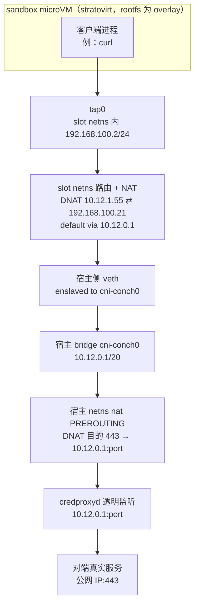

# Conch 沙箱接入透明捕获：机制与接入分析

日期：2026-11-04；2026-11-05 在运行中的沙箱 `a71db302-…`（slot-6）上完成端到端验证。每条结论标注依据：**读取**＝实际执行的命令或直接读取的文件；**推断**＝由读取到的事实推出，附推断依据。

## 0. 结论

- Conch 沙箱是 **stratovirt microVM**，运行在 conchd 预建的 **每 slot 一个网络命名空间**里；沙箱出网从 slot netns 的 `eth0` 进入宿主桥 `cni-conch0`（10.12.0.1/20），再经宿主 IP 栈转发出去。
- 接入透明捕获的方式与 libvirt VM 形态相同：**宿主 netns 的 `nat PREROUTING` 上，按入接口 `cni-conch0`、源子网 `10.12.0.0/20`、目的端口 443 做 DNAT**，指向 credproxyd 的透明监听。已在运行中的沙箱上实测：沙箱内的 curl 经捕获完成 TLS 握手，绑定主机收到 cred、未绑定主机收到 fakecred，审计分别记 `substitute` 与 `passthrough`（第 5 节）。
- git over HTTPS 也已在沙箱内跑通：匿名 clone 原样透传；以 fakecred 作 Basic 密码 push 时被替换，远端新建分支；无效 cred 的同形凭据 push 被上游 401 拒绝（审计仍记 `substitute`）。
- 与 VM 形态的主要差异不在捕获点，而在**客户端信任**：沙箱内 `jiuwenbox sandbox exec` 以 uid 1001 运行，`/etc` 不可写，无法在运行时把 CA 写入系统信任库并 `update-ca-trust extract`；本次端到端用 `curl --cacert` / git `http.sslCAInfo` 传入 CA。持久做法是烘焙进模板或经 conch volume 挂入（均未实测）。沙箱根文件系统是 overlay（lower 层为 erofs 镜像，经 virtio-pmem 提供），任何运行时改动也只落在 upper 层，随沙箱消失。
- 设计边界：只捕获 IPv4 TCP 443（guest 内核命令行 `ipv6.disable=1`）；宿主只能看到 slot 的 `10.12.1.x`，把流量归因到具体沙箱需要 conch 侧的 slot↔sandbox 映射，credproxy 自身没有这份信息。

## 1. 现状（2026-11-05）

以下命令均在本次会话执行：

- `sudo conch sandbox ls` →
  `a71db302-f7c6-4000-8000-0000bd6a69b6`，模板 `localhost/conch/tool-sandbox-flat:latest`，2 CPU、4096 MB，`STARTED_AT 2026-11-05T01:41:42Z`。
- `sudo jiuwenbox --base-url unix:///run/jiuwenbox/jiuwenbox.sock sandbox ls` → 同一 ID，`runtime=conch`，`ip_address=10.12.1.55`（另有 `runtime=process` 的 `173dd109-…`，与本文无关）。
- `pgrep -a stratovirt` → pid 1301932，`-m 4096M -smp 2`、`-netdev tap,id=net0,ifname=tap0`、`virtio-pmem-pci` 的 `mem-path=/var/lib/conch/containerd/io.containerd.snapshotter.v1.erofs/snapshots/504/layer.erofs`、`vhost-vsock-pci guest-cid=8`。
- 对 `/run/conch/netns/slot-*` 逐个检查 `tap0` 链路状态 → 只有 `slot-6` 的 `tap0` 为 `UP`，其余 `DOWN`，即该沙箱占用 slot-6。
- `journalctl -u conchd` 中该沙箱的记录直接给出 slot 与宿主侧地址：`stratovirt.go:247 ... nsenter --net=/run/conch/netns/slot-6`、`daemon.go:434 Sandbox created successfully sandbox_id=a71db302-… peer_ip=10.12.1.55`。

下面的分析以这个运行中的沙箱为实例；DNAT 规则按桥和源子网匹配，对之后创建的任何沙箱同样生效。

## 2. Conch 沙箱的网络实现

### 2.1 创建与运行

- conchd 以 `nsenter --net=/run/conch/netns/slot-N -- <stratovirt ...>` 启动每个沙箱的 VMM（**读取**：`journalctl -u conchd`，`stratovirt.go:247 Build start command ... script=/usr/bin/nsenter --net=/run/conch/netns/slot-6`）。
- VMM 的网络设备是 tap：`netdevs: {"net0": NetDevcfg { netdev_type: "tap", ifname: "tap0", vhost_kernel: false, queues: 2 }}`（**读取**：同一条日志里的 VmConfig）。
- 每个 slot netns 内的接口（**读取**：`nsenter --net=/run/conch/netns/slot-6 ip -br addr`，沙箱运行中）：

  ```
  eth0@if631  UP  10.12.1.55/20
  tap0        UP  192.168.100.2/24
  ```

  默认路由 `default via 10.12.0.1 dev eth0`；`ip_forward=1`（**读取**：同 netns 内 `ip route`、`sysctl net.ipv4.ip_forward`）。
- slot netns 内做 1:1 地址映射（**读取**：`nsenter --net=/run/conch/netns/slot-6 iptables -t nat -S`）：

  ```
  -A PREROUTING  -d 10.12.1.55/32  -j DNAT --to-destination 192.168.100.21
  -A POSTROUTING -s 192.168.100.21/32 -j SNAT --to-source 10.12.1.55
  ```

  即 guest 的地址是 `192.168.100.21`，它在宿主侧的对应地址是 netns eth0 的 `10.12.1.55`。guest 地址由 guest 内的 conch-init 配置（**读取**：`strings /var/lib/conch/conch.initrd` 提取的 conch-init 二进制含 `assign guest address`、`Guest network configured`、`guest interface does not have required address`）。
- 宿主桥（**读取**：`ip -d link show cni-conch0`、`bridge link show`）：`cni-conch0` 是 Linux bridge，地址 `10.12.0.1/20`，100 个宿主侧 veth 端口，对应预热的 100 个 slot。
- CNI 配置（**读取**：`/etc/conch/cni/net.d/10-conch.conf`）：`type=bridge`、`bridge=cni-conch0`、`isGateway=true`、`ipMasq=true`、host-local `10.12.0.0/20`、默认路由 `0.0.0.0/0`、DNS `223.5.5.5`/`8.8.8.8`。
- ipMasq 的落地：`nat POSTROUTING` 中每个 slot 一条 `CNI-<hash>` 链，链内 `MASQUERADE`（**读取**：`iptables -t nat -S`）。
- 出网转发：`FORWARD -i cni-conch0 -o wlp0s20f3 -j ACCEPT` 与反向各一条（**读取**：`iptables -S FORWARD`）。
- conchd 日志的 `Sandbox created successfully ... peer_ip=10.12.1.55`（**读取**：journal，同一 sandbox_id）与上述映射一致：宿主侧身份是 slot 的 `10.12.1.x`，不是 guest 的 `192.168.100.21`。

### 2.2 沙箱到公网 443 的包路径



回程（**读取**，第 5 节的端到端运行）：daemon 的回复源地址为 `10.12.0.1:port`、目的 `10.12.1.55`，经 `cni-conch0` 进入 slot-6 netns，netns 的 conntrack 反向翻译 SNAT，包以目的 `192.168.100.21` 到达 guest；沙箱内的 curl 收到完整响应体。

## 3. 接入点：宿主 netns 的 nat PREROUTING

### 3.1 规则

```sh
# 一条规则覆盖当前与之后创建的所有沙箱（全部落在 10.12.0.0/20）
iptables -t nat -I PREROUTING 1 \
  -i cni-conch0 -s 10.12.0.0/20 -p tcp --dport 443 \
  -j DNAT --to-destination 10.12.0.1:<port>
```

规则按**入接口**和**源子网**匹配，与 slot 编号、沙箱 ID 无关。conchd 重启后重建 slot netns、沙箱新建/删除都不需要改规则。

对照组：宿主上已有一条 libvirt VM 形态的规则（**读取**：`iptables -t nat -S PREROUTING`）：

```
-A PREROUTING -s 192.168.56.0/24 -i virbr-cpb -p tcp --dport 443 -j DNAT --to-destination 192.168.56.1:4111
```

两条规则的目标不同、匹配的桥和子网不同，互不影响。

### 3.2 已实测：宿主 PREROUTING 能看到并匹配运行中沙箱的流量

在沙箱内发起一次真实 HTTPS 请求，宿主用只做 LOG 的临时规则观察（规则执行后删除）：

```sh
iptables -t nat -I PREROUTING 1 -i cni-conch0 -s 10.12.0.0/20 -p tcp --dport 443 \
  -m limit --limit 20/min -j LOG --log-prefix "CPTEST-CONCH "
jiuwenbox --base-url unix:///run/jiuwenbox/jiuwenbox.sock sandbox exec a71db302-… -- \
  curl -sS -o /dev/null -w '%{http_code}\n' --max-time 15 https://example.com/
iptables -t nat -D PREROUTING -i cni-conch0 -s 10.12.0.0/20 -p tcp --dport 443 \
  -m limit --limit 20/min -j LOG --log-prefix "CPTEST-CONCH "
dmesg | grep CPTEST-CONCH
```

沙箱内 curl 返回 `code=200 ip=104.20.23.154 port=443`；宿主 LOG（**读取**）：

```
CPTEST-CONCH IN=cni-conch0 OUT= ... SRC=10.12.1.55 DST=104.20.23.154 LEN=60
             ... PROTO=TCP SPT=41574 DPT=443 WINDOW=64240 SYN
```

它同时证明：进入宿主的接口名是 `cni-conch0`；宿主看到的源地址是 slot netns 的 `10.12.1.55`（在 `10.12.0.0/20` 内，不是 guest 的 `192.168.100.21`）；沙箱内进程直接连接公网 `IP:443` 时，包确实经过宿主 `nat PREROUTING`。规则已删除，`iptables -t nat -S PREROUTING` 复查无 `CPTEST-CONCH` 行。

### 3.3 监听地址与原始目的地址

- credproxyd 在启动时绑定 `server.listen_transparent_vm` 给出的地址（**读取**：`credproxy/crates/credproxyd/src/main.rs:203-205`，`TcpListener::bind(addr)`），配置校验拒绝 loopback（**读取**：`credproxy/crates/credproxyd/src/config.rs:193-201`）。`10.12.0.1:4111` 是合法值。
- 监听收到的连接，`SO_ORIGINAL_DST` 由宿主 conntrack 给出 DNAT 前的目的地址＝客户端实际连接的公网 IP:443；这与 VM 形态走同一段代码（`serve_mitm`），审计里的 `original_dst` 即来自它。第 5 节实测：daemon 日志为 `vm: peer=10.12.1.55:46354 original_dst=162.159.142.41:443`、`vm: sni=postman-echo.com alpn=http/1.1`，与沙箱内 curl 解析到的 `postman-echo.com → 162.159.142.41` 一致。
- 选择 `10.12.0.1` 的理由：它就是 slot netns 的默认网关，回程无需额外路由。绑定宿主机其它地址（如 `wlp0s20f3` 的地址）也能工作——回程目的 `10.12.1.x` 走 `cni-conch0` 的直连路由——但多一项依赖，首选桥地址。

### 3.4 为什么不是其它接入点

- **不在 slot netns 里做**：slot netns 的 PREROUTING 已用于 1:1 地址映射（`-d 10.12.1.x → 192.168.100.21`）；在 netns 内再加 443 重定向，需要 netns 内也有监听并解决回注，而且规则要随 slot 复用/重建维护。宿主桥上一次配置覆盖全部 slot。
- **不用应用层代理（HTTP_PROXY/HTTPS_PROXY）**：需要每个客户端配合，不是透明捕获；沙箱里运行的任意工具不会自动遵守。
- **不改 CNI 配置**：捕获点在宿主 netns，CNI 仍只负责分配地址和 MASQUERADE。

## 4. 客户端信任（CA）

透明捕获在 TLS 层终止连接并出示由 credproxy CA 签发的叶子证书；沙箱 guest 必须信任该 CA，否则客户端在握手阶段失败（与 VM 形态的客户端信任矩阵同类问题）。

### 4.1 模板镜像里已有的东西（读取）

模板 `localhost/conch/tool-sandbox-flat:latest`（`conch template ls`）的 erofs 层 `…/snapshots/504/layer.erofs` 只读挂载后：

- `/etc/os-release`：openEuler 24.03 (LTS-SP3)。
- `/etc/pki/ca-trust/` 存在；`/usr/bin/update-ca-trust`、`/usr/bin/trust` 存在；`/etc/pki/ca-trust/source/anchors/` 为空目录。
- `/etc/pki/tls/certs/ca-bundle.crt` → `/etc/pki/ca-trust/extracted/pem/tls-ca-bundle.pem`；`/etc/ssl/certs` → `../pki/tls/certs`。
- `/usr/lib64/libcurl.so.4` 的字符串含 `/etc/pki/tls/certs/ca-bundle.crt`（该镜像的 curl 读这个路径，而不是 Debian 的 `ca-certificates.crt`）。
- `update-ca-trust` 调 `p11-kit extract --format=pem-bundle … $DEST/pem/tls-ca-bundle.pem`（读取脚本内容）。

推论（**推断**，依据上述路径）：以 root 把 CA 写入 `/etc/pki/ca-trust/source/anchors/` 并执行 `update-ca-trust extract` 后，镜像里的 curl 能读到该 CA。运行中的沙箱以 uid 1001 执行命令，`/etc/pki/ca-trust/source/anchors/` 属 root 且 `/etc` 不可写（第 4.3 节），因此当前沙箱内无法执行这一安装；python/Node 等是否读同一路径也需另外实测（VM 形态的教训是 Node 的默认通道是构建属性）。

### 4.2 根文件系统的可写性

conch-init 二进制中的字符串（**读取**：`strings /tmp/conch-initrd/sbin/conch-init`，initrd 来自 `/var/lib/conch/conch.initrd`）包含：

```
lowerdir=… upperdir=… workdir=…
/dev/pmem*
/mnt/conch/upper
/mnt/conch/work
/mnt/conch/merge
Failed to mount OverlayFS
Failed to chroot into merge layer, aborting init
Failed to create /dev/vda
```

说明 guest 根文件系统是 overlay：lower 层是经 virtio-pmem 提供的 erofs 镜像，upper/work 在 `/mnt/conch/` 下，chroot 进 `/mnt/conch/merge`。运行中的沙箱 `/proc/mounts` 给出同一结构（**读取**）：

```
overlay / overlay rw,relatime,lowerdir=/mnt/conch/pmem0,upperdir=/mnt/conch/upper,
workdir=/mnt/conch/work,redirect_dir=nofollow,index=off,uuid=null,xino=off,metacopy=off 0 0
```

即运行时写入 `/etc` 落在 upper 层，随沙箱生命周期消失，不会回到模板。

### 4.3 运行中的沙箱实测

同一个 `jiuwenbox sandbox exec` 会话内（**读取**）：

- `id` → `uid=1001 gid=1001 groups=1001`。
- `touch /etc/credproxy-probe` → `Permission denied`；`/tmp` 与 `/var/tmp` 可写，`/`、`/root`、`/home` 不可写。
- `/etc/pki/ca-trust/source/anchors/` 存在、属 root、为空；`/etc/pki/tls/certs/ca-bundle.crt` 仍是指向 `tls-ca-bundle.pem` 的符号链接（与 4.1 的镜像内容一致）。
- `jiuwenbox sandbox upload <id> <local> /tmp/credproxy-ca.pem` 可把宿主文件写进沙箱 `/tmp`（文件归 uid 1001），`sandbox exec` 能读到。
- `curl --cacert /tmp/credproxy-ca.pem` 完成对 credproxyd MITM 叶子的验证；第 5 节的替换与透传两个请求都由此建立 TLS。

因此，在当前沙箱配置下可用的运行时信任方式是**按请求指定 CA 文件**（`--cacert` / `CURL_CA_BUNDLE`；后者是替换语义）。写系统信任库需要以 root 运行（jiuwenbox 的 `conch.run_as_user` 在 `conch_policy.py:69-90`），本次未配置。

### 4.4 三种做法

1. **运行时安装（测试/演示）**：以 root 在沙箱里写 anchor + `update-ca-trust extract`；或以非 root 身份对单次请求用 `curl --cacert <file>` / `CURL_CA_BUNDLE`（替换语义，不是追加）。后者已在运行中的沙箱上验证（4.3、5）。
2. **烘焙进模板（部署）**：把 CA 放进 OCI 镜像的 anchors 并执行 extract，再用 `conch template create`（**读取**：`conch template --help`，`create Build a template from an OCI image, kernel, and initrd`）生成模板。当前模板来自本地 registry `127.0.0.1:5000/flat:latest`（`conch template ls` 的 SOURCE_REF），即需要重建并推送该镜像。
3. **经 conch volume 挂入（折中）**：conch 的卷后端是 virtiofs（**读取**：`/etc/conch/config.yaml` 的 `volume.backend: virtiofs`）；jiuwenbox 把 `conch.filesystem_policy.bind_mounts` 映射为 Conch 的 `volume_mounts`，并支持 `conch.env` 注入环境变量（**读取**：`jiuwenbox/server/conch_policy.py:102,169`、`configs/default-policy.yaml` 的 `conch` 段）。把 CA 文件挂进 guest，配合 `SSL_CERT_FILE`/`CURL_CA_BUNDLE` 使用。该路径未实测。

决策 38 的替换语义不受接入方式影响：只有已注册且凭据绑定当前 `host:port` 的 fakecred 被替换，未登记 fakecred、未绑定凭据、非 fakecred 认证材料原样转发。

### 4.5 覆盖差异

- curl（镜像内 libcurl 的默认 CA 文件路径已核对）；其他客户端（python `ssl`、Node、自带 bundle 的 Go/Java 程序）各自不同，需逐个验证，不能由 curl 的结果外推。

## 5. 端到端验证（已执行）

2026-11-05 在运行中的沙箱 `a71db302-…`（slot-6）上执行。使用 test-hooks 构建（`cargo build --release --features credproxyd/test-hooks --workspace`）的独立实例，不接触宿主上已部署的 credproxyd。

1. 启动临时 store：`credstore run --socket <work>/run/store.sock --data <work>/vault`。
2. 启动 daemon：bootstrap JSON 指向该 store 与 `<work>/run/mgmt.sock`，用 `--state-file` / `--lock-file` 把 daemon 自身配置与实例锁隔离到工作目录。
3. `credclient --mgmt-socket … settings set --listen-transparent-vm 10.12.0.1:<空闲端口>`，重启 daemon；日志出现 `VM transparent capture listener 10.12.0.1:44553 enabled`（本次运行端口）。
4. `credclient ca init` 导出 CA（1 张证书）；`credclient credential add --name conch-echo --agent conch-agent --allow-host postman-echo.com:443`，cred 经 stdin 传入，输出 fakecred。
5. `jiuwenbox sandbox upload <sandbox-id> <work>/ca.pem /tmp/credproxy-ca.pem`。
6. 插入第 3.1 节的 DNAT 规则，目标为该监听端口。
7. 在沙箱内执行（**读取**，两次请求）：
   - `curl -sS --cacert /tmp/credproxy-ca.pem -H "Authorization: Bearer <fakecred>" https://postman-echo.com/headers`
   - `curl -sS --cacert /tmp/credproxy-ca.pem -H "Authorization: Bearer <fakecred>" https://httpbun.com/headers`

结果（**读取**）：

- 绑定主机 `postman-echo.com`：响应体的 `authorization` 为 cred（`Bearer real-…`）；daemon 记 `vm: placeholder_hit credential=conch-echo host=postman-echo.com:443`、`vm: substituted credentials=conch-echo host=postman-echo.com:443`，审计 `decision=substitute`。
- 未绑定主机 `httpbun.com`：响应体的 `Authorization` 为 fakecred 原值；daemon 记 `vm: pass through placeholder of credential conch-echo not bound to httpbun.com:443`，审计 `decision=passthrough`。
- 原始目的地址：`vm: peer=10.12.1.55:46354 original_dst=162.159.142.41:443`，与沙箱内 curl 解析的 `remote_ip=162.159.142.41` 一致；`vm: sni=postman-echo.com alpn=http/1.1`。
- daemon 日志扫描：`grep -F "<cred>" daemon.log` 无匹配。
- 清理：停 daemon/store，删除 DNAT 规则；`iptables -t nat -S PREROUTING` 复查无 `10.12` 规则，无残留进程。

### 5.1 git over HTTPS（已执行）

在沙箱 `415ef935-…`（slot-12，peer_ip 10.12.1.48）与 `e1e52b9c-…`（peer_ip 10.12.1.51）上执行，仓库落在沙箱的工作区路径：

```
/home/agentos/workspace/projects/itrustee_tzdriver
```

该路径是 virtiofs 挂载（沙箱内 `/proc/mounts`：`none /home/agentos/workspace virtiofs rw,relatime 0 0`），不是 overlay upper，因此仓库内容保存在宿主侧的共享目录，而不是沙箱的 overlay 层。实测：原沙箱被删除后，后续沙箱 `e1e52b9c-…` 在同一路径仍能看到该仓库（HEAD `c281cbc`），即新沙箱挂载的是同一共享目录。

沙箱内 `git 2.43.0`；用 `-c http.sslCAInfo=/tmp/credproxy-ca.pem` 指定 MITM CA（该配置替换 git 的 CA bundle，本次只访问 atomgit.com）。凭据 `git-atomgit`（cred 为 AtomGit token，经 0600 文件以 `--value-file` 进入临时 vault）绑定 `atomgit.com:443`。

- 匿名 clone `https://atomgit.com/yinxyww/itrustee_tzdriver.git` 到上述路径 → 审计 `GET .../info/refs status=200 decision=passthrough` 与两次 `POST .../git-upload-pack status=200 decision=passthrough`。
- fakecred 可放在 push URL 的内联 userinfo，也可写进 `.git/config` 的 `remote.origin.url`（`git remote set-url origin 'https://yinxyww:<fakecred>@atomgit.com/…'`）。两种方式都由 git 在收到 401 后的 Basic 重试里发出，daemon 替换后审计 `POST .../git-receive-pack status=200 decision=substitute`；`.git/config` 与 daemon 日志都不含 cred。
- **固定分支策略**：测试统一推送到 `credproxy-test`；每次运行在仓库根的 `111.txt` 追加一行 UTC 时间戳，提交后 fast-forward 该分支，不为每次运行新建分支。连续两次运行实测：`19b0599…` → `2176188…` → `86eb719…`；宿主重新 clone 该分支复核，远端 `111.txt` 含两行时间戳，`git ls-remote` 指向 `86eb719…`。策略调整前按时间戳命名的测试分支仍在远端（第 6 节）。
- 负例：另建 `git-bad`（随机无效 cred，同样绑定 `atomgit.com:443`），用其 fakecred push → git 退出 128（上游 `HTTP Basic: Access denied`），审计 `GET .../info/refs status=401 decision=substitute`，证明 401 发生在替换之后而非 fakecred 原样发出。
- 日志扫描：daemon 日志不含真实凭据值。
- 过程特征：git 先发一条无认证的 `info/refs`（401、passthrough），再带 Basic 重试（此时才替换）。

判定点与 VM 用例一致：远端回显决定“替换/透传”，审计行决定归属，日志扫描决定泄露面。

## 6. 边界与未验证项

已核实：

- 宿主 PREROUTING 的入接口匹配与源地址（3.2 的 LOG 实测）。
- 沙箱数据面的地址映射：slot-6 的 DNAT/SNAT 规则、CNI 配置、宿主桥地址与端口（第 1、2.1 节）。
- 完整端到端：沙箱内 curl 经捕获完成 TLS 握手，替换与透传两个分支都由远端回显与审计行确认（第 5 节）。
- 回程经 slot netns conntrack 反解 SNAT 到达 guest（第 5 节，guest 收到完整响应体）。
- guest 根文件系统的 overlay 参数、`/etc` 不可写、`/tmp` 可写（4.2、4.3）。
- `curl --cacert` 与 git `http.sslCAInfo` 信任通道（第 5、5.1 节）。
- git over HTTPS：匿名 clone 透传、fakecred push 替换（远端建分支）、无效 cred push 401（第 5.1 节）。
- 模板镜像的 CA 存储布局与 curl 的编译期 CA 路径（4.1）。

未验证：

- 以 root 写系统信任库（anchor + `update-ca-trust extract`）；当前沙箱以 uid 1001 运行，未配置 `run_as_user`。
- 模板烘焙与 conch volume 挂载两种 CA 做法（4.4 的第 2、3 项）。
- 除 curl 外的客户端（python `ssl`、Node、Go、Java）在沙箱内的信任通道。
- conch 形态下的其余对照项（未登记 fakecred 401、非 443 不捕获、直连监听被拒）；这些在同一 daemon 代码路径上由 VM 用例覆盖，未在沙箱内逐项复跑。无效凭据 401 已由 5.1 的 `git-bad` 用例覆盖。
- 让常驻的 credproxyd 直接绑定 `10.12.0.1`：本文的端到端用的是隔离实例；宿主上已部署的进程（pid 3776986）仍只监听 `192.168.56.1:4111`、`127.0.0.1:4100/4110`（**读取**：`ss -ltnp`），不接受 conch 流量。

设计边界：

- 仅 IPv4 TCP 443：guest 内核命令行含 `ipv6.disable=1`（**读取**：journal 中的 `-append`），UDP/QUIC 443 不捕获，非 443 不捕获。
- DNS 由 CNI 配置的 `223.5.5.5`/`8.8.8.8` 解析，不影响捕获点。
- conch 控制面走 virtio-vsock（journal：`Connected to Stratovirt VM via AF_VSOCK … port=4065`），不经过该 DNAT 规则。
- 多沙箱共享一条规则；宿主只能看到源 `10.12.1.x`，要归因到具体沙箱需 conch 侧的 slot↔sandbox 映射，credproxy 自身没有这份信息。
- 固定分支名不能与既有引用同前缀：远端已有 `credproxy-e2e/<时间戳>`，因此 `refs/heads/credproxy-e2e` 无法创建（上游报 `cannot lock ref 'refs/heads/credproxy-e2e': 'refs/heads/credproxy-e2e/…' exists`）；当前固定分支用 `credproxy-test`。
- 沙箱内命令以非 root 用户运行（实测 uid 1001；jiuwenbox 的 `conch.run_as_user/run_as_group` 在 `conch_policy.py:69-90`），运行时改系统信任库的做法受此限制。

## 7. 与 libvirt VM 形态对照

| 项 | libvirt VM 形态 | conch 沙箱 |
|---|---|---|
| 客户端载体 | 独立 guest OS（openEuler 24.03 SP4） | stratovirt microVM，rootfs 为模板镜像的 overlay |
| 接入宿主的方式 | `vnet0` 挂 `virbr-cpb`，192.168.56.0/24 | slot netns 的 veth 挂 `cni-conch0`，10.12.0.0/20 |
| 宿主看到的源地址 | guest 自身地址 192.168.56.26 | slot 的 10.12.1.x（guest 的 192.168.100.21 在 slot netns 内被 1:1 转换） |
| 捕获规则 | `-i virbr-cpb -s 192.168.56.0/24 --dport 443` | `-i cni-conch0 -s 10.12.0.0/20 --dport 443` |
| 客户端信任库 | guest 系统信任库（`/etc/pki/ca-trust`），root 可写 | 模板镜像的 `/etc/pki/ca-trust`；exec 以 uid 1001 运行、`/etc` 不可写，实测用 `curl --cacert` |
| 生命周期与规则 | 规则与 VM 无关地静态存在 | 规则与 slot 无关地静态存在；slot 由 conchd 预热/复用 |
| 身份归因 | 源 IP / fakecred 凭据 | 同左；slot↔sandbox 映射在 conchd |

## 附：本文用到的复核命令

```sh
# 沙箱与 slot 归属
sudo conch sandbox ls
sudo jiuwenbox --base-url unix:///run/jiuwenbox/jiuwenbox.sock sandbox ls
pgrep -a stratovirt
sudo journalctl -u conchd --since '2026-11-05 01:40:00' --until '2026-11-05 01:45:00' \
  | grep -E 'nsenter|peer_ip'
for n in $(sudo ls /run/conch/netns); do sudo nsenter --net=/run/conch/netns/$n ip -br link show tap0; done

# slot-6 netns 的地址与 1:1 映射
sudo nsenter --net=/run/conch/netns/slot-6 ip -br addr
sudo nsenter --net=/run/conch/netns/slot-6 ip route
sudo nsenter --net=/run/conch/netns/slot-6 iptables -t nat -S
sudo nsenter --net=/run/conch/netns/slot-6 sysctl net.ipv4.ip_forward

# 宿主桥、转发与 CNI
ip -d link show cni-conch0
bridge link show
sudo iptables -t nat -S
sudo iptables -S FORWARD
cat /etc/conch/cni/net.d/10-conch.conf
sudo cat /etc/conch/config.yaml

# 运行中沙箱内的执行身份、可写性与信任库
jiuwenbox --base-url unix:///run/jiuwenbox/jiuwenbox.sock sandbox exec a71db302-… -- \
  sh -c 'id; touch /etc/probe; grep " / " /proc/mounts; ls -ld /etc/pki/ca-trust/source/anchors'

# 捕获点 LOG 实测（第 3.2 节；测完删除规则）
sudo iptables -t nat -I PREROUTING 1 -i cni-conch0 -s 10.12.0.0/20 -p tcp --dport 443 \
  -j LOG --log-prefix "CPTEST-CONCH "
sudo dmesg | grep CPTEST-CONCH

# 模板镜像核对（4.1、4.2）
sudo conch template ls
sudo mount -t erofs -o loop,ro \
  /var/lib/conch/containerd/io.containerd.snapshotter.v1.erofs/snapshots/504/layer.erofs \
  /mnt/conch-rootfs-check
strings /usr/lib64/libcurl.so.4 | grep /etc/pki        # 在挂载后的 rootfs 内
strings /tmp/conch-initrd/sbin/conch-init | grep -E 'overlay|upperdir|lowerdir|/mnt/conch'
```
