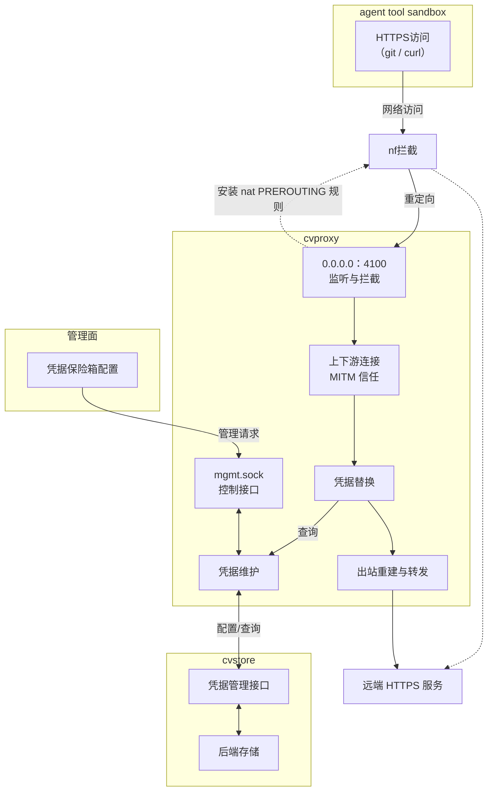
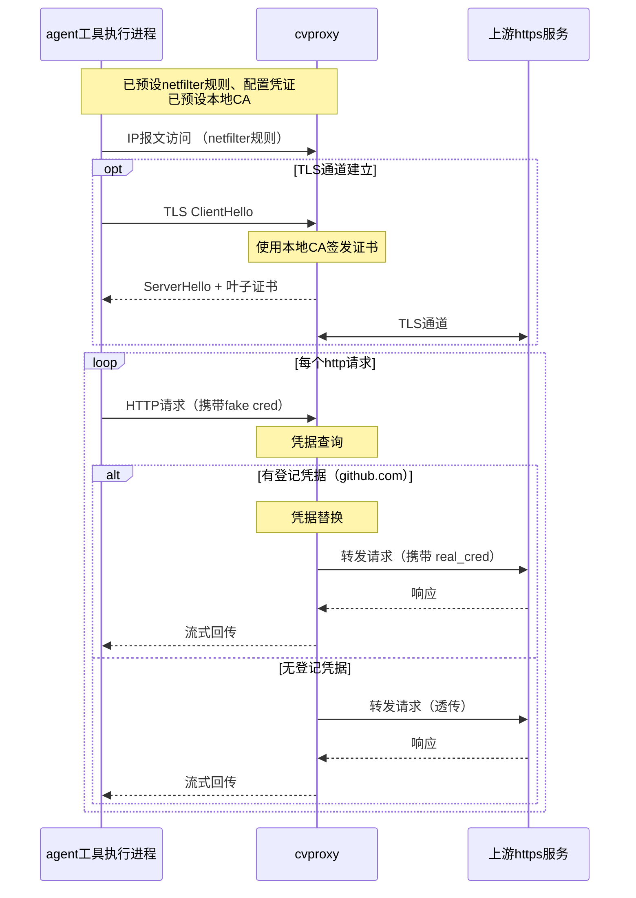
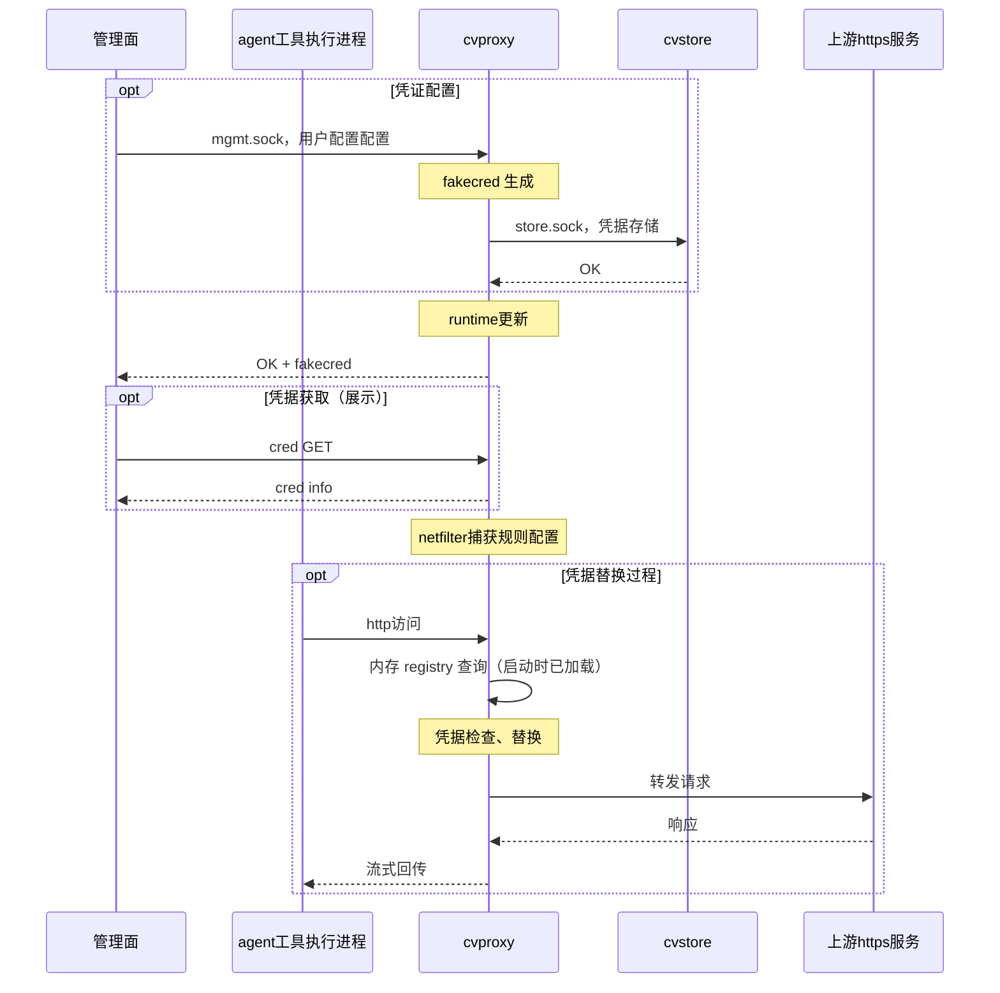
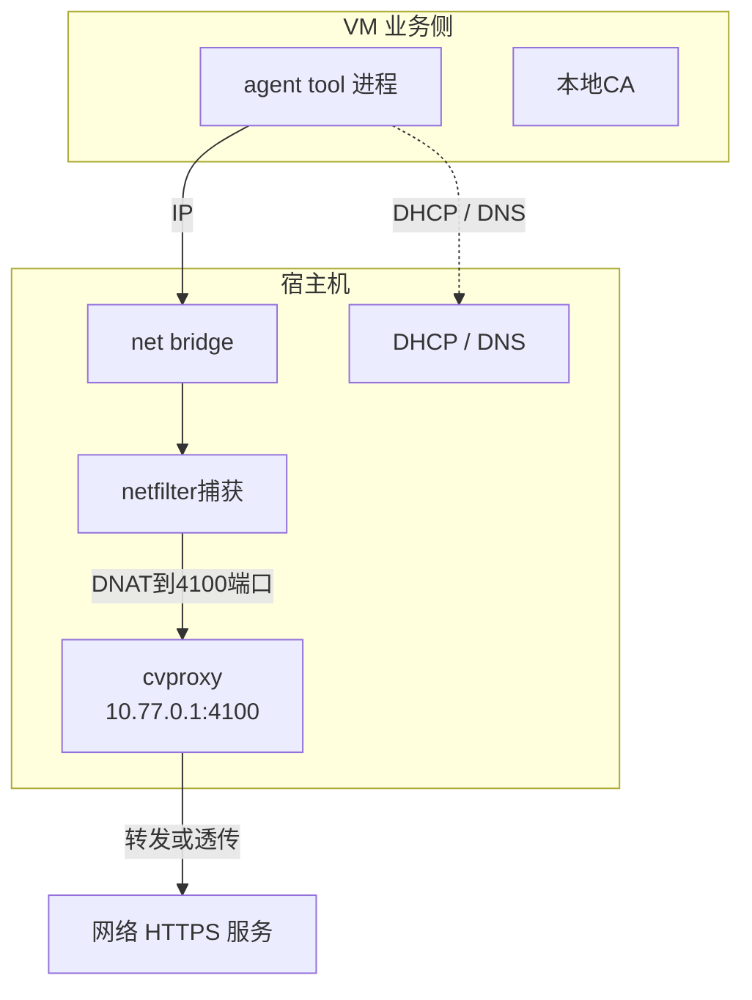
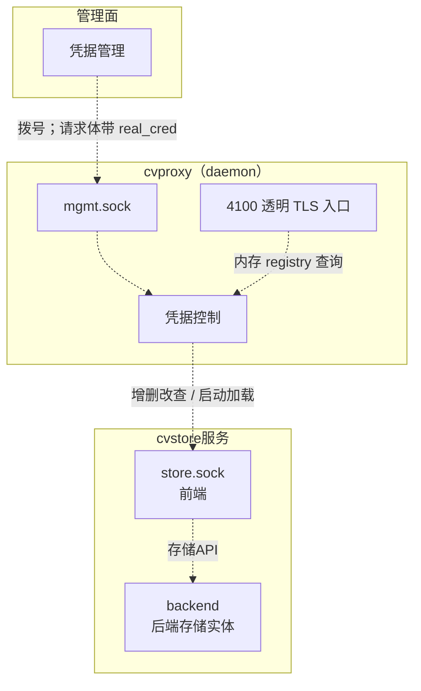
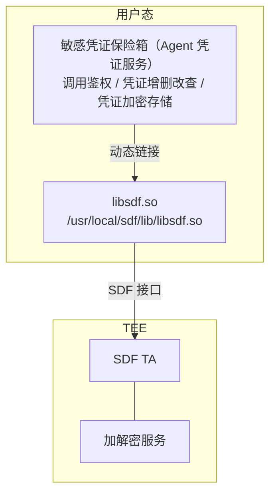

# credsvault 设计文档（凭据保险箱）

## 1. 概述

### 1.1 背景与目标

**背景**

agent在执行任务时，使用API key访问大模型，且存在以工具形式访问外部服务的场景；此前提中，API key、一些真实凭据**cred**（密码，Git仓库的令牌、其他网络服务的认证凭据等）会以真值形式存在于agent及其工具的执行环境中。
而工具执行环境具有网络访问能力，由于agent输出的不确定性，若被网络外部输入诱导，这些真实apikey、凭据存在泄漏风险。

**风险**

cred 一旦落在 agent 侧，就落入一个处理不可信输入、理论可执行任意命令、并把输出写回外部系统的组件：

- **提示注入**：agent 的上下文可能包含外部内容（网页、仓库文件、文本等），其中的指令或提示词可以诱导它读取、打印或转发 cred。

**目标**

通过本特性，让凭据真值不暴露给agent，消除凭据真值在运行环境中被泄漏的风险。
- **cred 不进入 agent 进程**：agent 侧只有 fake-cred，real-cred 只存在与服务内存、和存储服务后端中
- **最小授权**：real-cred 只发往特定host
- **存储机密性**：agent 进程读不到存储服务保存的real-cred

**方案概要**

本系统让 agent 持有的不是 cred，而是 **fakecred**（`fcred-<32字符随机键>` 这类本地随机字符串）。
agent 发出的请求仍带 fakecred；本地运行的可信代理进程在转发到外部服务之前，把
fakecred 替换成 cred。fakecred 只出现在 agent 与代理之间的本地连接上；代理连上游的请求只含 cred。
**realcred 全程不进入 agent 进程。**

### 1.2 范围

| 类别 | 内容 |
|---|---|
| **包括** | 通用 HTTPS 凭据替换（例如 git over HTTPS）；多 agent 共享一个 daemon；fakecred 生成、校验、管理；安全存储后端实现 ；统一管理面（`mgmt.sock`，HTTP/JSON，仅 root 可访问）；CA 与叶子证书签发 |
| **不包括** | fakecred 与 CA 向 agent 的交付：系统只生成并返回 fakecred 与 CA 证书，如何放进 agent 的 env/config/fakecred 文件/信任库由使用者自行决定并执行；不注入、不写 agent 侧文件、不提供注入工具 |

### 1.4 设计准则

1. 真凭据不直接触达 agent：agent 进程内、agent 可读的环境/配置/日志中不存在 cred。
2. 代理不会把真凭据发给 allowlist 之外的 host：绑定检查是强制的，不是可选开关。
3. fakecred 是本地能力：拿到 fakecred 能**使用**对应凭据（限绑定用途），但凭据值仍在代理手里；
   fakecred 泄漏不等于凭据泄漏。
4. 协议层判定不了就拒绝（目标既不能由 SNI 也不能由原始目的地址确定、非 HTTP、内层 Host 与已判定
   目标不一致）；认证层只做匹配替换：未登记、未绑定、非 fakecred 认证材料原样透传（§4.2.3、决策 38）。

### 1.5 方案限制

本方案不是对任意凭据、任意客户端、任意流量都成立，有以下限制：

- **限制一：凭据是请求头里的静态常量。**
- **限制二：当前仅支持HTTP/HTTPS协议**

## 2. 需求分析

### 2.1 使用场景

**覆盖的场景**

- **通用 HTTPS 凭据替换**：HTTPS 客户端访问需认证的 host 时，
  代理截获/转发请求，把 `Authorization` 等认证 header 里的 fakecred 换成 cred；客户端无感知，
  看到的地址不变。
- **多 agent / 多用户**：多个 agent 共享同一个代理进程；每个 agent 持有自己不同凭据的 fakecred。

### 2.2 功能性需求

按模块列出。它们共同保证本系统管理的 cred 不出现在 agent 进程、agent 可读的 env/config/日志中，
agent 侧只持有 fakecred；CA 与 fakecred 如何交付给 agent 由部署方完成。

| ID | 模块 | 需求 |
|---|---|---|
| R1 | 凭据配置 | 提供凭据的创建、查询、修改、删除与导出（导出默认不含真实值）；创建时生成并返回对应的 fakecred；写入前校验，成功后立即生效、无需重启；支持 CA 的生成与轮换；管理面仅 root 可调用；P2 提供管理面凭据页。 |
| R2 | 透明拦截 | 在不修改客户端地址与代理配置的前提下接管 agent/tool 的 HTTPS 出站流量，当前网桥粒度覆盖；代理按原始目标建立上游连接；无法确认请求目标时断开而不是放行。后续向精细化拦截演进 |
| R3 | 消息替换 | 识别请求头中携带的 fakecred，在转发前替换为对应 cred；替换只对绑定到该凭据的目标生效；未登记、未绑定或非 fakecred 的认证材料原样转发；请求目标或协议无法判定时拒绝；逐请求记录审计。 |
| R4 | 凭据存储服务 | 持久化保存每条凭据（目标、认证方式、定义与真实值）；仅代理进程可读写；提供原子写入、权限控制与可选加密；不解析业务内容、不联网、不参与策略判断与替换。 |
| R5 | OPT 前端 | 提供命令行管理入口，把凭据与配置操作提交给代理执行；自身不保存凭据；以退出码区分成功、操作失败、用法错误与校验违规。 |

### 2.3 非功能性需求

| ID | 类别 | 要求 |
|---|---|---|
| N1 | 安全性 | cred 只发往绑定目标；agent 进程读不到持久化状态 |
| N2 | 可用性 | 启动依赖缺失时报错退出，运行期不降级 |
| N3 | 可观测性 | 提供凭证、运行状态等信息的查询接口 |
| N4 | 性能 | 转发不在代理内缓冲，内存有界 |

### 2.4 约束条件

- **操作系统**：Linux
- **凭据前提**：请求头中的静态常量
- **流量前提**：捕获面是 IPv4 TCP；IPv6、UDP 不捕获。
- **使用者（部署方）职责**：fakecred 需要用户在与agent交互的过程中使用或者注入；本地CA需要部署到工具执行环境，用于解决MITM信任

## 3. 总体设计

### 3.1 架构概览

**组件划分**

| 模块 | 承载的功能 | 依赖组件 | 类型 |
|---|---|---|---|
| **cvproxy（daemon）** | 1. 监听与拦截 <br>2. 凭据与出站重建<br> 3. MITM 信任 <br> 4. 上游连接与流式转发<br> 5. 凭据配置和查询 | cvstore<br>netfilter | 独立进程 |
| **cvstore（凭据存储进程）** | 1. 提供凭据管理接口 <br>2. 负责凭据信息存储<br> | 无 | 独立进程 |
| **cvclient（CLI）** | 实现相关CLI命令 | cvproxy | OPT 命令 |

**周边组件**

| 组件 | 和需求组件的交互 |
|---|---|
| **agent tool** | 非安全组件，向远端发起网络访问，被 `cvproxy` 数据面拦截并处理，不直接访问 `cvstore`、`cvclient` |
| **网关 / 管理客户端** | 经 `mgmt.sock`（以 root 接入）与 `cvproxy` 交互，进行凭据等配置 |
| **netfilter（内核）** | 捕获规则由 `cvproxy` 启动时写入；内核按规则把目标 TCP 443 DNAT 到 `cvproxy` 的 `4100` 入口 |

**模块间关系**

- `cvclient` 通过 `mgmt.sock` 与 `cvproxy`  通信；网关/管理客户端走同一接口；
- `cvproxy` 通过 `store.sock`与`cvstore`进行交互，配置或查询凭证；
- agent tool 的流量由 netfilter模块路由到 `cvproxy` 的代理入口

组件关联（架构图）：



### 3.2 核心流程

#### 3.2.1 凭据保护主流程



#### 3.2.2 配置流程



#### 3.2.3 异常流程

| 异常场景 | 处理策略 |
|---|---|
| TLS 通道异常 | 断开连接 |
| HTTP 报文凭据匹配异常 | 透传 |
| 远端 HOST 未命中 | 不替换，透传 |
| 上游异常 | 透传错误 |
| 存储进程未启动/未就绪 | daemon 重试超时后退出（fail closed） |
| 启动加载失败 | daemon 退出；不启动缺 cred 或只加载部分 cred 的实例 |
| 运行期 `cvstore` 断开或崩溃 | 数据面继续用已加载的 `real_cred`；下一次管理面存储操作遇到致命错误时 daemon 退出 |
| daemon 崩溃 | `cvstore` 关闭该连接继续服务；新 daemon 重连后重新加载全部 `real_cred` |
| 第二个 daemon | 启动时获取独占锁失败即退出 |
| 管理面 bind 失败 | 进程退出，不允许无管理入口的常驻进程 |
| 自身配置损坏/字段非法 | 进程退出（fail closed）；缺失按默认值处理并告警 |
| 管理面写入失败 | 返回错误，内存不变；单对象写入不产生半条记录 |

## 4. 设计实现

### 4.1 接口设计

#### 4.1.1 cvproxy 接口

`cvproxy` 的对外接口包括数据面入站端口、管理面sock接口。

##### 4.1.1.1 数据面入站端口

透明捕获的流量入口，监听 `0.0.0.0:4100`，TCP 协议。通过系统层 netfilter 规则捕获流量。

##### 4.1.1.2 管理面入站 mgmt.sock

`/run/credsvault/mgmt.sock`：本需求唯一管理入口，HTTP/1.1 + JSON 协议工作；只开 AF_UNIX，不做 TCP/跨机。
socket 属主与属组为 `root:root`，socket 权限为 `0600`（仅属主可读写），父目录 `/run/credsvault` 权限为 `0755 root:root`。该接口仅接受 root uid 访问，服务端在 `accept` 后以 `SO_PEERCRED` 校验对端 uid。

**接口列表**

| 方法 | 路径 | 功能 | 入参 | 出参 |
|---|---|---|---|---|
| GET | `/v1/health` | 探活；`data_list` 探测 store 可达性，不改状态 | — | `status`（`ok`/`degraded`）<br>`version`<br>`listen_transparent`<br>`credentials`<br>`store`（`ok`/`unavailable`）<br>`uptime_ms` |
| GET | `/v1/credentials/list` | 列出全部 credential（含 fakecred，不含 `real_cred`） | — | `credentials[]`（每项为 credential 投影） |
| GET | `/v1/credential/get` | 按 `fake_cred` 读取；不存在 404 | `fake_cred`（query） | credential 投影 |
| POST | `/v1/credential/add` | 创建一条 credential（目标 + 认证方式 + real_cred 一起写入）；`name` 同名拒绝，`fake_cred` 由 daemon 生成 | `name`（body）<br>`type`（body，只允许 `https`）<br>`user_id`（body）<br>`user_name`（body）<br>`real_cred`（body）<br>`allowed_hosts`（body，非空）<br>`rules`（body，可选，v1 只接受空） | credential 投影（含 `fake_cred`） |
| POST | `/v1/credential/update` | 改元数据；不碰 `real_cred`；无字段变更返回 400 | `fake_cred`（query）<br>`name`（body，可选，同名拒绝）<br>`user_id`（body，可选）<br>`user_name`（body，可选）<br>`allowed_hosts`（body，可选）<br>`rules`（body，可选，v1 只接受空） | credential 投影 |
| POST | `/v1/credential/remove` | 按 `fake_cred` 删除该 credential 及其 `real_cred` | `fake_cred`（query） | `fake_cred` |
| GET | `/v1/validate` | 重读 daemon 自身配置与全部 `data/<fake_cred>`，列出不变量违规 | — | `violations[]` |
| GET | `/v1/dump` | 结构快照；默认打码 `real_cred` 与 CA 私钥，`secrets=true` 输出，`redacted=true` 裁剪 | `secrets`（query，可选，bool）<br>`redacted`（query，可选，bool） | `config`<br>`credentials` |
| POST | `/v1/ca/init` | 生成 CA 并写入 daemon 自身配置；已有 CA 时需 `force` 才轮换 | `force`（body，可选，bool） | `cert`（PEM） |

credential 投影固定为 `name`、`type`、`user_id`、`user_name`、`fake_cred`、`allowed_hosts`、`rules`，
不含 `real_cred` 与 `schema_version`。`fake_cred` 是存储与接口标识，生成后不可指定、不可修改；
`name` 必填、全局唯一、可改，改名不影响 `fake_cred`。

#### 4.1.2 cvstore 接口

`cvstore` 的接口摘要见本节，错误语义见本节正文；存储形式见 §4.2.5，backend 契约见
§4.2.5.1，运行期流向见 §4.2.5.2。wire 帧布局、超时与并发连接模型属实现细节。

##### 4.1.2.1 凭据接口（store.sock）

`/run/cvstore/store.sock`：AF_UNIX `SOCK_STREAM`。socket 属主与属组为 `root:root`，socket 权限为 `0600`，父目录 `/run/cvstore` 权限为 `0750 root:root`。`credstore` 在 `accept` 后以 `SO_PEERCRED` 校验对端 uid，要求对端 uid 等于 `credstore` 进程 uid。

**接口列表**

| 接口 | 功能 | 入参 | 出参 |
|---|---|---|---|
| `data_put` | 创建或整对象覆盖写；单 path 原子替换 | `fake_cred`<br>`content` | `status` |
| `data_get` | 读整个对象；不存在 → `NOT_FOUND` | `fake_cred` | `status`<br>`content`（`OK` 时） |
| `data_delete` | 删除对象；不存在 → `NOT_FOUND` | `fake_cred` | `status` |
| `data_list` | 枚举对象名，不返回 content | — | `status`<br>`fake_creds[]`（`OK` 时） |

`data_list` 的 fakecred 名单超限返回 `TOO_LARGE`，不截断。错误按类别返回，
错误体不含 content；调用方收到未知错误码按失败处理。`cvproxy` 是唯一客户端；接口没有 credential
专用操作，也没有跨命名空间事务。`real_cred` 不要求唯一，存储层不索引、不去重、不解析业务 JSON。

传输为 AF_UNIX `SOCK_STREAM` 上的版本化、长度分帧协议，每个请求自包含，一条连接同一时间只有
一个 in-flight 请求；服务端在 `accept` 后通过 `SO_PEERCRED` 校验对端 uid。

##### 4.1.2.2 存储后端接口

属 `cvstore` 内部接口，不对外暴露；原语、路径规则与实现要求见 §4.2.5.1。

#### 4.1.3 cvclient 接口

`cvclient` 是凭据保险箱提供的CLI命令，通过
`mgmt.sock` 与后端`cvproxy`通信。

**命令列表**

| 命令 | 功能 | 入参 | 出参 | 管理面接口 |
|---|---|---|---|---|
| `ca init` | 生成 CA 并写入 daemon 自身配置；`--force` 轮换根 | `--force` | `cert`（PEM，写 stdout） | `POST /v1/ca/init` |
| `credential add` | 创建一条 credential：目标 + 认证方式 + `real_cred`；`name` 同名拒绝，`fake_cred` 由 daemon 生成 | `--name`<br>`--type`（只允许 `https`）<br>`--user-id`<br>`--user-name`<br>`--allow-host`（可重复，非空）<br>`--value-file` 或 `--value-stdin`（`real_cred`，不经 argv）<br>`--rule`（可重复，JSON，v1 只接受空） | credential 投影（含 `fake_cred`） | `POST /v1/credential/add` |
| `credential update` | 改元数据；不碰 `real_cred`；无字段变更返回 400 | `--fake-cred`<br>`--name`（可选，同名拒绝）<br>`--user-id`（可选）<br>`--user-name`（可选）<br>`--allow-host`（可选，可重复）<br>`--rule`（可选，可重复，v1 只接受空） | credential 投影 | `POST /v1/credential/update?fake_cred=` |
| `credential remove` | 按 `fake_cred` 删除 credential 及其 `real_cred`（轮换的前半程） | `--fake-cred` | `fake_cred` | `POST /v1/credential/remove?fake_cred=` |
| `validate` | 重读 daemon 自身配置与全部 `data/<fake_cred>`，列出不变量违规 | — | `violations[]`；有违规退出码 3 | `GET /v1/validate` |
| `dump` | 结构快照；默认打码 `real_cred` 与 CA 私钥 | `--secrets`<br>`--redacted`<br>`--format json` | `config`、`credentials` | `GET /v1/dump` |


### 4.2 功能设计

#### 4.2.1 透明捕获机制

透明捕获解决“agent 的出站连接如何到达代理、代理如何知道原始目的地”的问题。

透明捕获在内核网络层完成，通过netfilter模块把业务进程的网络访问改投到 `cvproxy` 的监听端口 4100，业务进程不感知代理进程。



**涉及规则语义**

| 钩子 / 链 | 规则语义 |
|---|---|
| `nat PREROUTING` | 入接口为 VM bridge、源地址属于 VM 子网、目标 TCP 443 的包，DNAT 到网关 `4100`；其余不动 |
| `filter FORWARD` | 先丢弃伪造源（源不在 VM 子网）；再放行到网关的 DNS/853；其余转发出站放行，不做目的 allowlist |
| `nat POSTROUTING` | 对非捕获出站做源 NAT，使上游有回程路由；被捕获的 443 已投递到本机，不走这条 |
| `filter INPUT` | 放行 VM 子网到网关的 DHCP、DNS 与 `4100`；其余从 bridge 进入本机的流量丢弃 |
| `filter OUTPUT` | 不向 VM 开放管理面；VM 只经 libvirt console/guest agent 管理 |

规则由 `cvproxy` 启动时安装到独立链（如 `CREDSVAULT`），先校验再安装，重复启动幂等；规则安装
失败则 daemon 启动失败。正常停止或崩溃都保留规则，只有卸载/显式清理才删除，避免 daemon 不在时
VM 流量绕过代理直连。

#### 4.2.2 MITM 信任

透明捕获把 TCP 连接改投到 cvproxy 后，cvproxy需要处理TLS通道带来的消息机密性问题。
代理要让客户端接受自己出示的证书，才能读到明文请求；同时又必须保持对上游站点的证书校验。

方案是使用本地 CA 签发叶子证书，`cvproxy` 用叶子证书与客户端建立TLS通道，再以独立 TLS
连接访上游HTTPS服务，并用标准信任根校验证书。
该方案的前提是客户端信任本地CA。

**证书与信任规则**

- CA 与私钥由 `cvproxy` 生成并持久化，属于 daemon 自身配置；首次启动若缺失自动生成。CA 证书是
  公开材料，由部署方分发。
- 叶子证书每次握手时按已判定目标签发：域名目标使用 DNS SAN，IP 目标使用 IP SAN。
- 目标判定：ClientHello 有域名 SNI 时用 SNI；无 SNI 时用 `SO_ORIGINAL_DST` 的原始目的 IP；
  SNI 为 IP 字面量时必须与原始目的 IP 一致。上游 TLS 相应使用域名或 IP 的 `ServerName`。
- CA 轮换使用 `ca init --force`：写入新 CA 后 daemon 即时切换，新握手使用新 CA；部署方同时
  更换 agent 侧信任文件，旧叶子随旧信任文件一起失效。换根窗口内连接全断，应择低峰执行。
- TLS 两侧都只协商 ALPN `http/1.1`：`cvproxy` 作服务端时只提供 `http/1.1`，作客户端时也只向
  上游提供 `http/1.1`。两侧都按 HTTP/1.1 解析和转发。

#### 4.2.3 凭据处理过程

当单个 HTTP 请求到达代理后，需要判定两件事：是否携带 fakecred；命中的 fakecred 是否满足替换
条件。

方案是在 HTTP 请求头层做发现与匹配：按完整 fakecred 查 registry，用 host 绑定与可选的
`rules` 决定是否替换；命中后只替换对应 header 值，其余请求原样转发；每种不满足条件的情况有固定处置。

**匹配规则**

透明 HTTPS 入口下，一个请求被替换，必须同时满足以下条件：

1. 已判定 TLS 目标：有域名 SNI 时目标为 SNI；无 SNI 时目标为 `SO_ORIGINAL_DST` 的原始目的 IP；
   SNI 为 IP 字面量时必须与原始目的 IP 一致。两者都没有或互相矛盾则断开。
2. 请求头识别到已登记 fakecred。
3. 内层 Host 与已判定目标一致：域名按大小写不敏感比较，IP 按字面量比较；端口只接受空或 `443`。
   Host 不一致时拒绝，不做替换。
4. 该 fakecred 的 `allowed_hosts` 包含已判定目标；不包含时原样透传，不替换。

#### 4.2.4 凭据格式

业务侧需要一个能写进 HTTP 消息、与 `real_cred` 无关的 fakecred；
代理需要从 fakecred 反查到唯一 `real_cred`，并通过一定格式把认证方式、约束等相关信息保存起来。

**fakecred 格式**

前缀 `fcred-` 加 32 个小写 hex 字符，共 38 字节，UUIDv7 生成，例如
`fcred-0198a7c4d2f37a8e9b1c5d6e7f8a9b0c`。fakecred 以原始形态使用；`fake_cred` 字段值就是
agent 侧看到的值。

**凭据相关信息**

| 字段 | 语义 |
|---|---|
| `schema_version` | 必须为 1；其他值整体拒绝 |
| `name` | 凭证名称，1–64 字符，`[A-Za-z0-9._-]`，首字符为字母或数字；必填、全局唯一、可改 |
| `type` | 类型字段；当前只允许 `https`，接口与加载都校验 |
| `user_id` | 归属用户 id，1–128 字符，`[a-z0-9_-]` |
| `user_name` | 归属用户名，1–128 字符，`[a-z0-9_-]`；必填 |
| `fake_cred` | fakecred 本体（格式见上文）：`fcred-` 加 32 个小写 hex 字符，全局唯一，作为存储键与 API 标识 |
| `real_cred` | 真值，内联在本对象：1–1024 字符、≤4096 字节、不含 NUL、必须是合法 HTTP header 值；不要求全库唯一 |
| `allowed_hosts` | 非空数组；每项为域名或 IP 字面量（V1 捕获面仅 IPv4）；不写端口、scheme、路径，不允许通配符；域名大小写不敏感，IP 精确匹配 |
| `rules` | 仅 `https`；省略或 `null` 表示无操作级限制；v1 拒绝非空值 |

`schema_version` 不是 1 的对象整体拒绝；旧 schema 3 的 `data/credential.<id>` 不读取、不迁移、
不兼容，升级流程在 daemon 启动前删除旧对象后重建。

示例：

```json
{
  "schema_version": 1,
  "name": "git-atomgit",
  "type": "https",
  "user_id": "u-01",
  "user_name": "alice",
  "fake_cred": "fcred-0198a7c4d2f37a8e9b1c5d6e7f8a9b0c",
  "real_cred": "<real-secret>",
  "allowed_hosts": ["atomgit.com"],
  "rules": null
}
```

#### 4.2.5 凭据存储

`real_cred` 不能由 agent 直接读取，也不能散落在 cvproxy 的配置里，所以额外实现了 cvstore 用于凭据信息的存储。

`cvstore` 进程作为独立服务，对外提供本机可访问的sock 接口，接口有身份鉴权。
`cvstore` 只负责持久化与访问控制，与网络和业务逻辑无关，它不提供通用文件 API，只提供凭据相关的API。

**cred 的存储形式**
每条凭据的相关信息存储在一个逻辑对象中，多条凭据分开存储，内容为 JSON 格式，使用 `fake_cred`
作为对象键。例如 Linux fs 后端时，每个凭据单独一个文件 `data/<fake_cred>`，文件名为 fakecred。

落盘形态由 backend 实现后端决定，但需遵循上述约定。

**进程边界**：`cvstore` 是纯存储与权限边界，不是 release condition，也不是策略引擎；它不判断
content 中是否含 cred，所有“不得输出 `real_cred`”的投影由 daemon 完成。daemon 与 `cvstore` 的 uid
都能读到全部 `real_cred`，`cvstore` 保护的是持久化状态与文件权限，不是“daemon 拿不到 cred”。启动时一次性
加载并校验全部 credential，不做懒加载；任一校验失败即退出。CA 私钥属于 daemon 自身配置，不在
`cvstore` 的权限或加密边界内。

##### 4.2.5.1 存储后端

`cvstore` 的业务逻辑只依赖 backend 接口，不依赖具体存储形态；
backend 只接收逻辑路径与不透明字节，不解释业务语义。
具体存储后端通过配置文件配置。

backend 必须实现以下原语。

| 原语 | 约定 |
|---|---|
| `read` | 读取整个对象 |
| `write` | 整体替换写；单 path 原子；成功返回前完成持久化 |
| `delete` | 删除对象 |
| `list` | 枚举对象，只返回元数据（名字），不返回 content |
| `stat` | 只返回单对象元数据，不返回 content |

**路径**：由若干非空段组成；段不能是 `.`/`..`、不能含 NULL。

##### 4.2.5.2 数据在运行过程中的流向



#### 4.2.6 基于 TEE 的内生国密凭据存储

本节描述"敏感凭证保护方案"中凭证加密存储的一种实现：基于鲲鹏内生国密的凭据加密方案。

##### 4.2.6.1 组成与调用关系

| 层 | 组件 | 职责 |
|---|---|---|
| 用户态 | 凭据存储服务（cvstore） | 调用鉴权、凭证增删改查、凭证加密存储 |
| 用户态 | `libsdf.so` | 凭证保险箱服务动态链接 `/usr/local/sdf/lib/libsdf.so`，提供 SDF 接口 |
| TEE | `SDF TA` | 提供内生国密（SDF）能力 |
| TEE | `加解密服务` | TEE内提供的加解密、秘钥派生能力 |



cvstore服务动态链接 `"/usr/local/sdf/lib/libsdf.so"`，使用内生国密（SDF）提供的接口生成密钥，
对凭据加密存储；解密时使用 SDF 接口获取密钥。

##### 4.2.6.2 SDF 国密加密流程

1. `init_sdf_provider("/usr/local/sdf/lib/libsdf.so")`：加载 SDF 动态库
2. `SDF_OpenDevice()` → `device_handle`
3. `SDF_OpenSession()` → `session_handle`
4. `SDF_GetKEKAccessRight()`：获取 KEK 权限
5. `SDF_GenerateKeyWithKEK()`：生成会话密钥并用 KEK 加密导出
6. `SDF_Encrypt()`：使用会话密钥进行国密加密
7. 写入 `creds_secrets.json`（包含加密后的会话密钥 + 密文）
8. `SDF_ReleaseKEKAccessRight()`：释放权限
9. `SDF_CloseSession()`
10. `SDF_CloseDevice()`

##### 4.2.6.3 SDF 国密解密流程

1. 读取 `creds_secrets.json`
2. `init_sdf_provider("/usr/local/sdf/lib/libsdf.so")`
3. `SDF_OpenDevice()` → `device_handle`
4. `SDF_OpenSession()` → `session_handle`
5. `SDF_GetKEKAccessRight()`：获取 KEK 权限
6. `SDF_ImportKeyWithKEK()`：导入加密的会话密钥
7. `SDF_Decrypt()`：使用会话密钥进行国密解密
8. 发起 LLM 请求时按需获取密钥
9. 请求完成后立即销毁（不驻留内存）
10. `SDF_ReleaseKEKAccessRight()`：释放权限
11. `SDF_CloseSession()`
12. `SDF_CloseDevice()`

##### 4.2.6.4 要点

- 密钥由 SDF 接口生成，KEK 在 TEE 内提供；会话密钥以 KEK 加密后与密文一起落盘（`llm_secrets.json`），
  落盘内容不含明文密钥与明文凭据。
- 解密后的密钥按需获取，请求完成后立即销毁，不驻留内存。


### 4.3 部署方式

cvproxy、cvstore作为服务形式，运行在host侧系统中。

| 二进制 | 职责 | 运行身份 |
|---|---|---|
| `cvproxy` | 数据面 daemon：ingress、TLS、registry、policy、rewrite、上游连接、审计、统一管理面、store client | root（V1；独立用户为后续） |
| `cvstore` | 存储进程：AF_UNIX IPC + backend | root（V1；独立用户为后续） |
| `cvclient` | 管理 OPT | 管理员（root），无常驻进程 |

## 5. AgentOS 场景兼容方案

本章描述Jiuwen AgentOS场景下，凭据保险箱的使能和兼容方案，包括场景分析、差异化设计等内容。

### 5.1 AgentOS 场景分析

- Jiuwen AgentOS场景，支持单个物理机上多用户，沙箱隔离；
- 每个用户有两个沙箱：bwrap沙箱（进程级，用于运行agent）与 Conch沙箱（虚拟机，用于agent执行tool exec）；本需求中凭据指的是工具中使用的密码，key等，所以bwrap沙箱不在本需求范围内，主要针对Conch沙箱。
- conch沙箱访问网络时，流量经tap传到host侧创建的子netns中；子netns连接到网桥上，从init netns中的一个虚拟网卡中访问网络，其中会经过NAT；
- 每个conch沙箱都经过同一个网桥，处于同一个局域网中，每个沙箱IP不同。

### 5.2 透明捕获机制适配

Jiuwen场景中，所有conch沙箱都会通过网桥访问网络，此场景下可对网桥的数据包做过滤，把所有子网IP的流量都重定向到我们的监听端口。

网桥子网为10.12.0.0网段，监听端口为4100时，示例如下：
```
iptables -t nat -I PREROUTING 1 \
  -i cni-conch0 -s 10.12.0.0/20 -p tcp --dport 443 \
  -j DNAT --to-destination 10.12.0.1:4100
```

之后可考虑区分IP进行规则配置，可优化对未设置凭据保险的沙箱的网络访问。

### 5.3 凭据管理和格式适配


- 凭据相关字段：AgentOS 场景下，每个物理机上可能有多个用户，通过 `user_id` 与 `user_name`
  区分，每个用户当前仅一个 agent。两者都是 credential 的必填字段：1–128 字符，字符集
  `[a-z0-9_-]`；用户多 agent 场景另行设计。

- 凭据配置：凭据由用户在管理面进行配置，设置 `real_cred`、`type` 等相关字段，用户隔离；

- 凭据展示：管理面可展示当前用户的所有凭据信息，`real_cred` 默认匿名展示；接口返回
  `fake_cred`，不返回 `real_cred`；

- 凭据使用：由客户在管理面获取`fake_cred`之后，与agent在交互过程中使用，系统无自动导入操作；

## 6. 可拓展功能

- Git over SSH协议支持；
- host 与 bwrap 沙箱形式捕获；
- 每用户/每沙箱的细粒度捕获
- TrustedZone 安全存储（V1 见 §4.2.6 基于鲲鹏内生国密的凭据加密方案）

## 7. 系统依赖

### 7.1 对 agent runtime 与客户端的依赖

| 依赖 | 要求 | 说明 |
|---|---|---|
| 信任注入通道 | 客户端能信任本地 CA，或使用系统信任库 | 本方案依赖客户端信任本地CA处理TLS通道 |

## 附录

### A. 术语表

| 术语 | 定义 |
|---|---|
| fakecred | 假凭据值，暴露给agent使用，泄漏无安全风险 |
| real_cred | 真实凭据值，不应该暴露给agent |
| 透明捕获 | 在网络层把 agent 的出站连接转移到代理端口，客户端无感知 |
| MITM | 代理用本地 CA 与客户端创建TLS通道，再以独立 TLS 连接上游 |
| `SO_ORIGINAL_DST` | 用 `getsockopt` 获取原始目标地址 |
